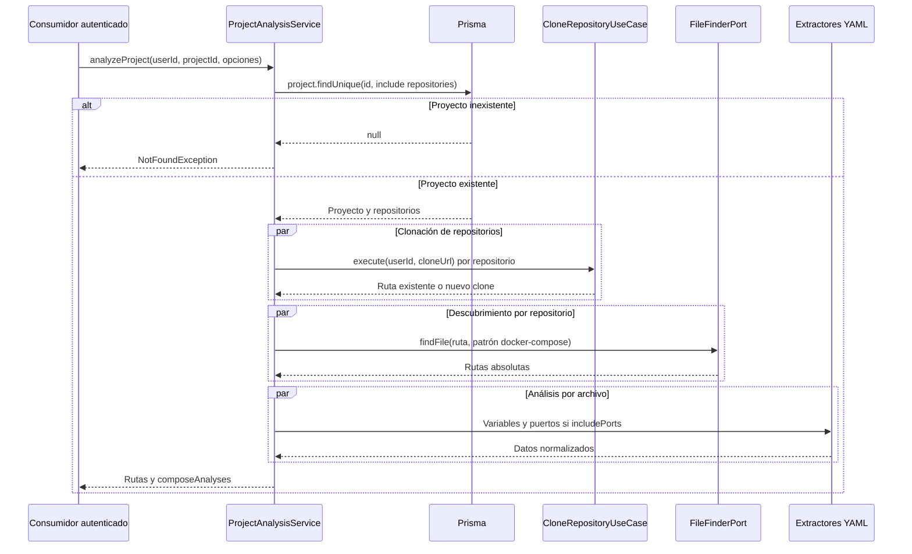

---
tags:
  - neoglito
  - analisis
  - documentacion-tecnica
funcionalidad: analisis
actualizado: 2026-10-10
---

# Análisis · flujo

## Etapas

1. `getComposeFiles` busca el proyecto por `projectId`, incluyendo todos sus repositorios asociados.
2. Clona o reutiliza cada repositorio usando la conexión GitHub de `userId`. Espera el `Promise.all` de clonaciones antes de iniciar la búsqueda.
3. Ejecuta búsquedas por repositorio en paralelo y aplana los resultados en `dockerFilesPath`.
4. `analyzeProject` analiza cada ruta encontrada en paralelo. Por archivo, también ejecuta variables y puertos en paralelo; cada extractor lee y parsea el YAML por separado.
5. Devuelve `clonedRepositoryPaths`, `dockerFilesPath` y `composeAnalyses`.

`includePorts` vale `true` por defecto. Con `false`, no se invoca el extractor de puertos y el resultado interno contiene `ports: []` para cada archivo. El consumidor HTTP `/project/init` elimina además esa propiedad de su respuesta.

## Casos vacíos y fallos

Un proyecto sin repositorios devuelve las tres listas vacías. Si hay repositorios pero no archivos compatibles, conserva las rutas clonadas y devuelve `dockerFilesPath: []` y `composeAnalyses: []`.

Una excepción de clonación, lectura o extracción rechaza la operación completa: no hay respuesta parcial de análisis. `Promise.all` no cancela las operaciones ya iniciadas. Un fallo puede dejar clones creados en disco; no hay rollback de esas carpetas.

Los arreglos producidos por `Promise.all` conservan el orden de sus entradas, aunque las operaciones terminen en otro orden. No hay `orderBy` en la consulta de repositorios ni ordenación explícita de las entradas del sistema de archivos: no se garantiza un orden estable de candidatos.

El descubrimiento aislado `getComposeFiles` termina antes de la etapa de extracción. Lo utiliza el despliegue para comprobar que el Compose solicitado está entre los archivos del proyecto.

## Fuentes del código

- [src/analisys/application/project-analysis.service.ts](file:///C:/Users/Uriel-Galvan/Documents/Proyectos%20Programacion/neoglito/src/analisys/application/project-analysis.service.ts)
- [src/deployment/presentation/deployment.controller.ts](file:///C:/Users/Uriel-Galvan/Documents/Proyectos%20Programacion/neoglito/src/deployment/presentation/deployment.controller.ts)
- [src/deployment/application/use-cases/deploy-compose.use-case.ts](file:///C:/Users/Uriel-Galvan/Documents/Proyectos%20Programacion/neoglito/src/deployment/application/use-cases/deploy-compose.use-case.ts)
- [src/shared/infrastructure/files/recursive-file-finder.service.ts](file:///C:/Users/Uriel-Galvan/Documents/Proyectos%20Programacion/neoglito/src/shared/infrastructure/files/recursive-file-finder.service.ts)
