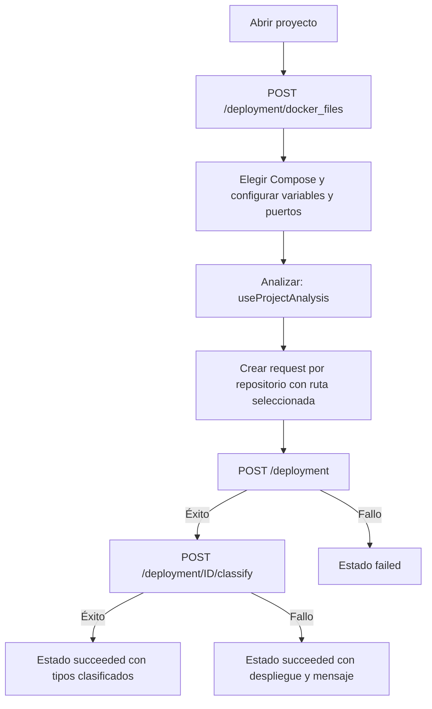

---
tags:
  - neoglito
  - analisis
  - documentacion-tecnica
funcionalidad: analisis
actualizado: 2026-10-10
---

# Análisis · uso y frontend

## Apertura de un proyecto

`useProjectOpen.handleOpenProject(projectId)` abre el panel y llama a `projectService.environmentVariables({ projectId })`. Ese nombre es un alias de `dockerFilesPath`: ambos hacen POST `/deployment/docker_files` y devuelven el análisis completo.

Con una respuesta exitosa, `compose.helpers.ts` asocia los resultados a repositorios usando el nombre corto y la carpeta del clone. Normaliza separadores, compara nombres sin distinguir mayúsculas y selecciona las rutas Compose contenidas bajo el directorio identificado.

El hook envía al estado de despliegues tres acciones:

| Acción | Datos que prepara |
| --- | --- |
| `deploy-paths-discovered` | Candidatos y primer Compose por repositorio |
| `deploy-env-discovered` | Filas de variables editables |
| `deploy-ports-discovered` | Filas de puertos declarados |

La primera ruta candidata queda seleccionada; no hay una prioridad explícita para `docker-compose.yml` frente a variantes. Todas las filas incluyen `dockerComposePath` para asociarlas al archivo correspondiente.

Para variables literales, el formulario toma `value`; para interpoladas, `defaultValue` o string vacío. Marca `required` cuando `source === 'interpolation'` y `defaultValue === null`. Es una regla del formulario, no una reproducción completa de la semántica de Compose: una variable que podría heredarse del host se marca requerida por esa regla.

Si falla la petición, el hook registra el mensaje en el panel del proyecto. `projectService.init` existe como cliente de `/project/init`, pero el hook de apertura revisado utiliza el análisis completo, incluidos puertos.

## Botón Analizar: despliegue y clasificación

`startAnalysis` toma los repositorios del proyecto con una ruta seleccionada no vacía. Abre el estado de análisis con cada repositorio en `pending`. Para cada uno construye la solicitud con `createDeploymentRequest` y lanza `deploymentService.deployAndClassify` sin esperar a los demás; no hay un límite de concurrencia explícito.

`deployAndClassify` primero despliega. Si funciona, clasifica el despliegue creado. Si la clasificación falla, conserva la respuesta exitosa del despliegue y devuelve `classificationError`: el reducer registra `succeeded` acompañado del mensaje. Si falla el despliegue o la construcción de su solicitud, registra `failed`.

La interfaz invalida consultas de puertos después de resolver la operación. `analysisReducer` mantiene proyecto, repositorios, despliegues, mensajes, grupos colapsados, selección y pestaña (`services` o `relations`). Es estado React; no una tabla ORM de análisis.

`closeAnalysis` limpia ese estado y vuelve a la fase del proyecto. No ejecuta una llamada de parada: cerrar la vista no detiene los contenedores que ese flujo desplegó. La vista de relaciones utiliza un componente placeholder; no debe interpretarse como evidencia de relaciones calculadas por `ProjectAnalysisService`.

## Integración con el backend de despliegues

Antes de crear un despliegue, `DeployComposeUseCase` llama a `getComposeFiles`. Comprueba que la ruta solicitada coincide con uno de los candidatos del proyecto. Una ruta externa genera `BadRequestException` con `El archivo Compose no pertenece al proyecto seleccionado`.

Esta verificación utiliza descubrimiento, no extracción de variables o puertos. La preparación del YAML, reserva de puertos, ejecución Docker y persistencia de estados pertenecen al módulo de despliegue y sus adaptadores. El clasificador de contenedores constituye otra responsabilidad distinta de la lectura inicial de Compose.

## Fuentes del código

- [apps/web/src/features/projects/hooks/use-project-open.ts](file:///C:/Users/Uriel-Galvan/Documents/Proyectos%20Programacion/neoglito/apps/web/src/features/projects/hooks/use-project-open.ts)
- [apps/web/src/features/projects/project.service.ts](file:///C:/Users/Uriel-Galvan/Documents/Proyectos%20Programacion/neoglito/apps/web/src/features/projects/project.service.ts)
- [apps/web/src/features/projects/compose.helpers.ts](file:///C:/Users/Uriel-Galvan/Documents/Proyectos%20Programacion/neoglito/apps/web/src/features/projects/compose.helpers.ts)
- [apps/web/src/features/projects/hooks/use-project-analysis.ts](file:///C:/Users/Uriel-Galvan/Documents/Proyectos%20Programacion/neoglito/apps/web/src/features/projects/hooks/use-project-analysis.ts)
- [apps/web/src/features/projects/deployment.service.ts](file:///C:/Users/Uriel-Galvan/Documents/Proyectos%20Programacion/neoglito/apps/web/src/features/projects/deployment.service.ts)
- [apps/web/src/features/analysis/analysis.reducer.ts](file:///C:/Users/Uriel-Galvan/Documents/Proyectos%20Programacion/neoglito/apps/web/src/features/analysis/analysis.reducer.ts)
- [apps/web/src/features/projects/components/analyze/analyze-relations-placeholder.tsx](file:///C:/Users/Uriel-Galvan/Documents/Proyectos%20Programacion/neoglito/apps/web/src/features/projects/components/analyze/analyze-relations-placeholder.tsx)
- [src/deployment/application/use-cases/deploy-compose.use-case.ts](file:///C:/Users/Uriel-Galvan/Documents/Proyectos%20Programacion/neoglito/src/deployment/application/use-cases/deploy-compose.use-case.ts)
