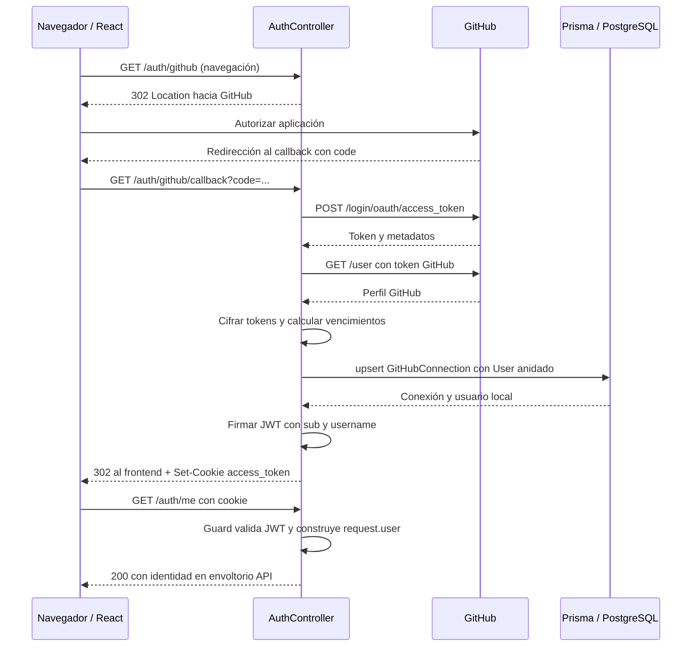

---
tags:
  - neoglito
  - autenticacion
  - documentacion-tecnica
funcionalidad: autenticacion
actualizado: 2026-10-10
---

# Autenticación · flujo

## Inicio de sesión completo

El backend inicia OAuth con `scope=read:user user:email`. Consulta el perfil `/user`, pero no consulta un endpoint de correos ni almacena email en User. El intercambio del código incluye el mismo callback configurado.

Si no existe una conexión con ese `githubId`, se crea junto con un User. Si existe, se actualizan perfil y credenciales conservando el ID local. Después se firma un JWT de una hora y se establece la cookie. El navegador vuelve a `FRONTEND_URL` o a `http://localhost:5174`.

## Recuperar sesión al abrir la aplicación

`AuthProvider` comienza en `loading` y llama a `/auth/me`. Si obtiene `success: true` con datos, cambia a `authenticated`. Cualquier respuesta fallida produce `unauthenticated`, incluidos errores de red. `ProtectedRoute` muestra la espera durante loading o redirige a `/authentication` si falta sesión.

## Qué sucede después

Cada endpoint con `JwtAuthGuard` valida el JWT; no vuelve a ejecutar OAuth. El guard obtiene la identidad de sus claims. Listar repositorios y clonar sí consultan GitHubConnection por `userId` y descifran el token GitHub para operar con el proveedor.

El JWT y el token GitHub pueden dejar de ser válidos en momentos diferentes. Que `/auth/me` funcione no demuestra que una operación posterior con GitHub vaya a funcionar.

Relacionadas: [[Autenticacion - ORM y persistencia]], [[Autenticacion - JWT cookie y cifrado]], [[Autenticacion - Uso y frontend]].

## Fuentes del código

- [src/auth/presentation/authentication.controller.ts](file:///C:/Users/Uriel-Galvan/Documents/Proyectos%20Programacion/neoglito/src/auth/presentation/authentication.controller.ts)
- [apps/web/src/features/auth/auth-context.tsx](file:///C:/Users/Uriel-Galvan/Documents/Proyectos%20Programacion/neoglito/apps/web/src/features/auth/auth-context.tsx)
- [src/repository/application/use-cases/repository/get-repositories.use-case.ts](file:///C:/Users/Uriel-Galvan/Documents/Proyectos%20Programacion/neoglito/src/repository/application/use-cases/repository/get-repositories.use-case.ts)
- [src/repository/application/use-cases/repository/clone-repository.use-case.ts](file:///C:/Users/Uriel-Galvan/Documents/Proyectos%20Programacion/neoglito/src/repository/application/use-cases/repository/clone-repository.use-case.ts)
