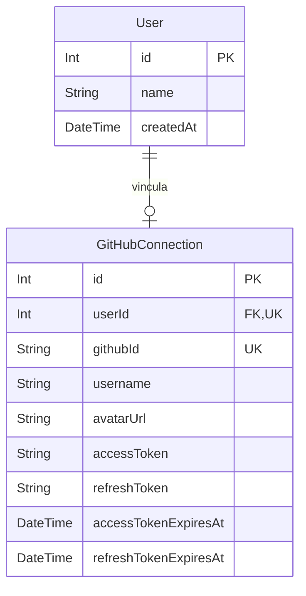

---
tags:
  - neoglito
  - autenticacion
  - documentacion-tecnica
funcionalidad: autenticacion
actualizado: 2026-10-10
---

# Autenticación · ORM y persistencia

## Modelos Prisma



| Campo | Tipo / nulabilidad | Regla y significado |
| --- | --- | --- |
| User.id | Int requerido | PK autoincremental; identidad local |
| User.name | String requerido | Nombre GitHub o login como fallback |
| User.createdAt | DateTime requerido | Default now() |
| User.githubConnection | GitHubConnection opcional | Un usuario puede existir sin conexión |
| GitHubConnection.id | Int requerido | PK autoincremental |
| userId | Int requerido, único | FK User.id; una conexión por usuario |
| githubId | String requerido, único | Identidad estable GitHub y clave de upsert |
| username / avatarUrl | String requerido | Perfil sincronizado en cada login |
| accessToken | String requerido | Token GitHub cifrado |
| refreshToken | String nullable | Refresh token GitHub cifrado si se recibe |
| accessTokenExpiresAt | DateTime nullable | Vencimiento calculado o null |
| refreshTokenExpiresAt | DateTime nullable | Vencimiento calculado o null |

La conexión exige User y declara `onDelete: Cascade`. Borrar el usuario elimina su conexión. Borrar la conexión no implica borrar el usuario. La migración `20260923211500_add_auth_models` crea ambas tablas, índices únicos y FK con cascada de eliminación y actualización.

## Upsert durante el callback

Primero se cifran accessToken y refreshToken, si llega este último. Después se realiza una sola llamada Prisma:

```typescript
prisma.gitHubConnection.upsert({
  where: { githubId: profile.githubId },
  create: { /* conexión y user.create */ },
  update: { /* conexión y user.update */ },
  include: { user: true },
})
```

Es un upsert con escrituras anidadas; no hay una transacción manual separada en el caso de uso.

| Dato | Primera autenticación | Nueva autenticación |
| --- | --- | --- |
| User | Crea name; id/createdAt por defecto | Actualiza name; conserva id/createdAt |
| githubId | Inserta clave única | Se utiliza para localizar, no se actualiza |
| username, avatarUrl | Inserta | Reemplaza con perfil nuevo |
| accessToken | Inserta cifrado | Reemplaza cifrado |
| accessTokenExpiresAt | Calcula o null | Calcula o null; puede borrar vencimiento anterior |
| refreshToken | Cifrado o null | Solo actualiza si llega un valor truthy; de lo contrario conserva el anterior |
| refreshTokenExpiresAt | Calcula o null | Solo actualiza si refreshTokenExpiresIn no es undefined |

El vencimiento usa `new Date(Date.now() + expiresIn * 1000)`. Sin duración devuelve null; cero segundos produce una fecha correspondiente al momento del cálculo.

## Lecturas posteriores

`/auth/me` no consulta estas tablas: devuelve claims validados del JWT. Repositorios y clonado consultan `gitHubConnection.findUnique({ where: { userId } })` y descifran accessToken. Las fechas almacenadas no se usan para renovar tokens automáticamente en los flujos revisados.

La conexión ORM usa PostgreSQL con `PrismaPg` y DATABASE_URL. La configuración `prisma7.config.ts` apunta a la carpeta `prisma`, donde los modelos se separan en archivos.

Relacionadas: [[Autenticacion - Implementacion backend]], [[Autenticacion - JWT cookie y cifrado]].

## Fuentes del código

- [prisma/models/user.prisma](file:///C:/Users/Uriel-Galvan/Documents/Proyectos%20Programacion/neoglito/prisma/models/user.prisma)
- [prisma/models/github-connection.prisma](file:///C:/Users/Uriel-Galvan/Documents/Proyectos%20Programacion/neoglito/prisma/models/github-connection.prisma)
- [prisma/migrations/20260923211500_add_auth_models/migration.sql](file:///C:/Users/Uriel-Galvan/Documents/Proyectos%20Programacion/neoglito/prisma/migrations/20260923211500_add_auth_models/migration.sql)
- [src/auth/application/authenticate_with_github.ts](file:///C:/Users/Uriel-Galvan/Documents/Proyectos%20Programacion/neoglito/src/auth/application/authenticate_with_github.ts)
- [src/prisma/prisma.service.ts](file:///C:/Users/Uriel-Galvan/Documents/Proyectos%20Programacion/neoglito/src/prisma/prisma.service.ts)
- [prisma7.config.ts](file:///C:/Users/Uriel-Galvan/Documents/Proyectos%20Programacion/neoglito/prisma7.config.ts)
