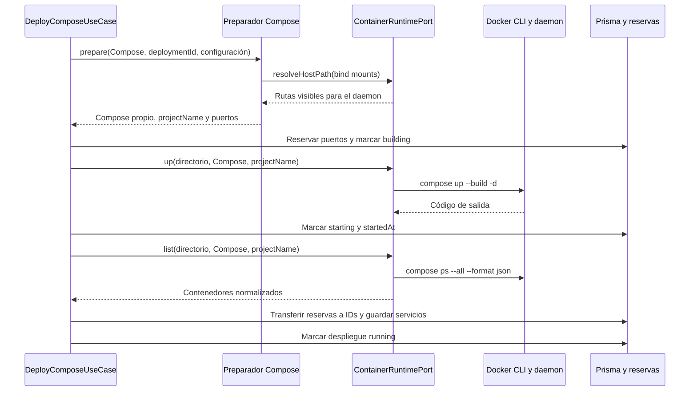

---
tags:
  - neoglito
  - container
  - documentacion-tecnica
funcionalidad: container
actualizado: 2026-10-10
---

# Container · flujo

## Creación y observación

El descubrimiento de Compose y su pertenencia al proyecto se validan antes de crear el registro de despliegue. La preparación del YAML y las reservas no forman parte de `DockerComposeRuntime`.

`up` termina cuando Docker Compose sale con código 0. No espera un estado healthy ni sondea los contenedores hasta que estén running. El caso de uso hace un listado después; si no hay contenedores, lanza un error. Si sí hay, persiste sus estados y marca el **despliegue** como running, incluso si el estado observado de algún contenedor es otro.

## Fallo de arranque

El coordinador marca que se intentará iniciar el runtime antes de llamar a `up`, porque Docker podría crear recursos parcialmente antes de fallar. En su catch intenta `down` si existe un Compose preparado. Si falla esa limpieza, registra el error y continúa con la liberación de reservas. Después intenta marcar el despliegue failed y propaga el fallo.

No hay una transacción distribuida entre Docker, Redis y PostgreSQL. La limpieza es un intento de compensación; los fallos durante liberación o escritura pueden interrumpir el resto de ese catch. `ContainerModule` no realiza rollback ORM por sí mismo.

## Clasificación

`ClassifyDeploymentServicesUseCase` carga el despliegue y sus servicios, llama a `list` y exige que cada servicio persistido siga presente y esté running. Permite contenedores sin puerto publicado. Luego llama a `inspect` para todos los contenedores observados y entrega el contexto al clasificador.

El clasificador utiliza imagen, protocolos y evidencia adicional; para configuraciones de servidores web solicita `readFile` y `listFiles`. Esas llamadas ejecutan `docker exec`, pero no interpretan por sí mismas el contenido.

Tras clasificar, el caso de uso guarda tipo, puerto, estado, health y fecha observada en una transacción Prisma. Resultados no resueltos quedan como `UNKNOWN`. Los errores de observación/inspección se transforman en `ConflictException` en ese consumidor.

## Parada

`StopDeploymentUseCase` marca stopping, llama a `down`, libera las reservas por ID de contenedor y actualiza los servicios a exited/none. Marca el despliegue stopped con finishedAt. Si algo falla dentro de ese bloque, intenta marcar failed y vuelve a lanzar el error.

`down` ejecuta Compose down, no pause ni stop aislado: elimina los contenedores y redes que corresponda gestionar a Compose. Las filas de servicios permanecen como historial. `delete` añade flags de volúmenes y huérfanos, pero no se encontró un consumidor de ese método en los casos de uso revisados.

## Fuentes del código

- [src/deployment/application/use-cases/deploy-compose.use-case.ts](file:///C:/Users/Uriel-Galvan/Documents/Proyectos%20Programacion/neoglito/src/deployment/application/use-cases/deploy-compose.use-case.ts)
- [src/deployment/application/use-cases/classify-deployment-services.use-case.ts](file:///C:/Users/Uriel-Galvan/Documents/Proyectos%20Programacion/neoglito/src/deployment/application/use-cases/classify-deployment-services.use-case.ts)
- [src/deployment/infrastructure/compose/yaml-deployment-compose.service.ts](file:///C:/Users/Uriel-Galvan/Documents/Proyectos%20Programacion/neoglito/src/deployment/infrastructure/compose/yaml-deployment-compose.service.ts)
- [src/container/infrastructure/docker/docker-compose-runtime.service.ts](file:///C:/Users/Uriel-Galvan/Documents/Proyectos%20Programacion/neoglito/src/container/infrastructure/docker/docker-compose-runtime.service.ts)
- [src/ports/infrastructure/classification/container-classification.service.ts](file:///C:/Users/Uriel-Galvan/Documents/Proyectos%20Programacion/neoglito/src/ports/infrastructure/classification/container-classification.service.ts)
