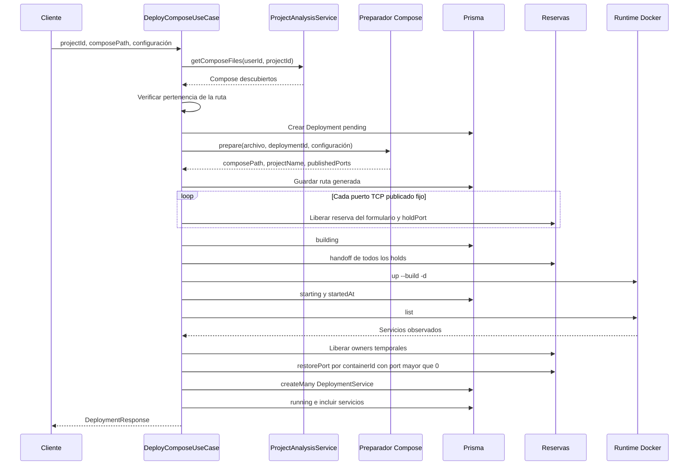
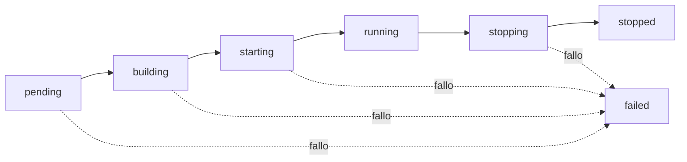

---
tags:
  - neoglito
  - deployment
  - documentacion-tecnica
funcionalidad: deployment
actualizado: 2026-10-10
---

# Deployment · flujo y estados

## Desplegar

La pertenencia se compara normalizando con `resolve`, separadores `/` y minúsculas. También se hace en Linux, donde puede ignorar diferencias de mayúsculas del sistema de archivos. Se ejecuta el archivo candidato descubierto, no la cadena recibida directamente.

La creación de pending ocurre antes del bloque de preparación. Una configuración inválida puede dejar un registro failed; una ruta que no pertenezca al proyecto se rechaza antes de crear el registro.

El endpoint espera todo el caso de uso: no devuelve un job ni inicia una cola en segundo plano. Docker usa modo detached, pero su proceso Compose debe finalizar para que la petición continúe.

## Estados

Es el recorrido habitual del coordinador, no una máquina de estados validada. Stop no restringe el estado previo. Clasificar tampoco exige explícitamente Deployment.status running; exige que sus contenedores persistidos estén presentes y running en la observación actual.

`startedAt` se escribe después de que up termina. El estado running del despliegue se guarda después de observar y persistir servicios. No se espera health healthy ni se comprueba que todos los servicios observados estén running; una lista no vacía basta para continuar el despliegue.

## Compensación de fallos

Antes de llamar a up se establece `runtimeStarted = true`. Si up crea recursos parcialmente y falla, el catch intenta down sobre el proyecto generado. Si falla down, registra el error y continúa. Luego libera los owners temporales y los owners de contenedores que alcanzaron a restaurarse, escribe failed/finishedAt y propaga el error.

No elimina el YAML generado ni borra las filas de servicios que ya se hubieran creado. Si una liberación o escritura falla, puede interrumpir el resto de la compensación. Las operaciones paralelas mediante Promise.all no se cancelan cuando una de ellas rechaza. No hay atomicidad entre Docker, archivos, Redis y PostgreSQL.

## Detener

Stop carga el despliegue o devuelve 404; escribe stopping y ejecuta down usando el composePath guardado. Después consulta los IDs persistidos, libera sus reservas, actualiza servicios a exited/none y lastObservedAt, y guarda stopped/finishedAt.

Down elimina los contenedores y redes gestionados por Compose. No usa la variante delete con `--volumes --remove-orphans`. Conserva filas y valores port como historial. Un fallo dentro del bloque de parada intenta escribir failed; ese catch no actualiza finishedAt. La escritura inicial de stopping está fuera de ese catch.

## Clasificar

Clasificación carga servicios y rechaza una lista vacía. Observa Docker y verifica cada ID persistido y su estado running. Inspecciona todos los contenedores observados para aportar contexto de uso mutuo; exige inspección y resultado para cada servicio guardado.

Guarda tipo resuelto o UNKNOWN, puerto, status, health y una fecha común mediante `$transaction`. No cambia el estado del despliegue ni sus fechas de inicio/fin. No agrega nuevos servicios ni sustituye IDs si Docker recreó un contenedor. Fallos de listado/inspección se convierten a 409; otros errores del clasificador pueden propagarse como 500.

## Fuentes del código

- [src/deployment/application/use-cases/deploy-compose.use-case.ts](file:///C:/Users/Uriel-Galvan/Documents/Proyectos%20Programacion/neoglito/src/deployment/application/use-cases/deploy-compose.use-case.ts)
- [src/deployment/application/use-cases/classify-deployment-services.use-case.ts](file:///C:/Users/Uriel-Galvan/Documents/Proyectos%20Programacion/neoglito/src/deployment/application/use-cases/classify-deployment-services.use-case.ts)
- [src/container/infrastructure/docker/docker-compose-runtime.service.ts](file:///C:/Users/Uriel-Galvan/Documents/Proyectos%20Programacion/neoglito/src/container/infrastructure/docker/docker-compose-runtime.service.ts)
