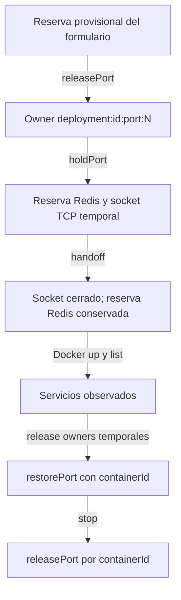

---
tags:
  - neoglito
  - deployment
  - documentacion-tecnica
funcionalidad: deployment
actualizado: 2026-10-10
---

# Deployment · ORM y reservas

## Modelos Prisma

| Deployment | Tipo y uso |
| --- | --- |
| id | String @id, default uuid |
| projectId | Int, FK Project con onDelete Cascade |
| composePath | String, ruta del YAML generado tras preparación |
| status | DeploymentStatus, default pending |
| createdAt | DateTime, default now |
| startedAt / finishedAt | DateTime opcionales |
| services | Relación DeploymentService[] |

Índice compuesto projectId/createdAt. No existe una restricción de un único deployment activo por proyecto o por archivo.

| DeploymentService | Tipo y uso |
| --- | --- |
| id | String @id sin default; ID observado de Docker |
| composeServiceName | String |
| port | Int, un puerto TCP observado o 0 |
| status / health | ContainerStatus / ContainerHealth |
| serviceType | ServiceType, default UNKNOWN |
| lastObservedAt | DateTime, default now |
| deploymentId | String FK Deployment con onDelete Cascade |

Índices deploymentId y status. Port no es unique y no tiene una restricción de rango declarada en el schema. La cascada de base de datos no detiene Docker ni libera Redis.

## Escrituras

La creación y arranque usan varias escrituras independientes: pending, composePath, building, starting/startedAt, createMany de servicios y running. Los servicios inicialmente quedan UNKNOWN. No hay una transacción que englobe ese recorrido.

La clasificación actualiza las filas de servicios en una transacción Prisma y vuelve a cargar el despliegue. La parada conserva los servicios y sus port, y escribe exited/none, lastObservedAt y stopped/finishedAt. La respuesta general mantiene esos port históricos; la consulta específica de puertos devuelve null cuando ya no considera activo el despliegue.

## Ciclo de reservas



Por cada TCP fijo del YAML final, libera primero `draftPortOwnerId(projectId, port)`. Después holdPort abre un socket TCP en 0.0.0.0 del entorno de la API y reserva el par de claves Redis:

```text
port-reservation:port:<N> → ownerId
port-reservation:owner:<ownerId> → N
```

El owner temporal es `deployment:<deploymentId>:port:<N>`. El hold tiene timeout predeterminado de 30 segundos; handoff cancela el timeout y cierra el socket para que Docker pueda publicar. No transfiere de forma atómica un socket a Docker. La disponibilidad comprobada pertenece al entorno de la API, que puede diferir del host del daemon.

Después de list libera todos los owners temporales y restaura solo servicios con port > 0, usando containerId. restorePort no prueba disponibilidad TCP porque Docker puede estar ocupando el puerto; registra el par Redis sin TTL, acepta el par idéntico y rechaza conflictos.

## Límites de consistencia

Un YAML puede publicar muchos puertos, pero runtime.list y DeploymentService conservan uno por servicio. Tras liberar los holds, solo los puertos observados y transferidos quedan reservados por containerId. UDP no participa. Publicaciones asignadas por Docker se registran después del arranque.

Clasificar puede actualizar el port ORM sin actualizar su reserva Redis. No hay monitor periódico que sincronice cambios externos de Docker. Startup reconstruye reservas de servicios guardados running/paused/restarting con port > 0; no comprueba Docker. Ver [[Startup - ORM y Redis]].

La liberación devuelve boolean, pero desplegar y detener no exigen true. Un error Redis sí puede abortar el caso de uso. Una falla tardía puede dejar registros, archivos o recursos pendientes aunque se intente compensar. El estado failed no implica limpieza completa.

## Fuentes del código

- [prisma/models/deployment.prisma](file:///C:/Users/Uriel-Galvan/Documents/Proyectos%20Programacion/neoglito/prisma/models/deployment.prisma)
- [src/deployment/application/use-cases/deploy-compose.use-case.ts](file:///C:/Users/Uriel-Galvan/Documents/Proyectos%20Programacion/neoglito/src/deployment/application/use-cases/deploy-compose.use-case.ts)
- [src/deployment/application/use-cases/classify-deployment-services.use-case.ts](file:///C:/Users/Uriel-Galvan/Documents/Proyectos%20Programacion/neoglito/src/deployment/application/use-cases/classify-deployment-services.use-case.ts)
- [src/ports/application/port-reservation.port.ts](file:///C:/Users/Uriel-Galvan/Documents/Proyectos%20Programacion/neoglito/src/ports/application/port-reservation.port.ts)
- [src/ports/application/draft-port-owner.ts](file:///C:/Users/Uriel-Galvan/Documents/Proyectos%20Programacion/neoglito/src/ports/application/draft-port-owner.ts)
- [src/ports/infrastructure/reservations/redis-port-reservation.service.ts](file:///C:/Users/Uriel-Galvan/Documents/Proyectos%20Programacion/neoglito/src/ports/infrastructure/reservations/redis-port-reservation.service.ts)
- [src/startup/restore-deployment-port-reservations.service.ts](file:///C:/Users/Uriel-Galvan/Documents/Proyectos%20Programacion/neoglito/src/startup/restore-deployment-port-reservations.service.ts)
