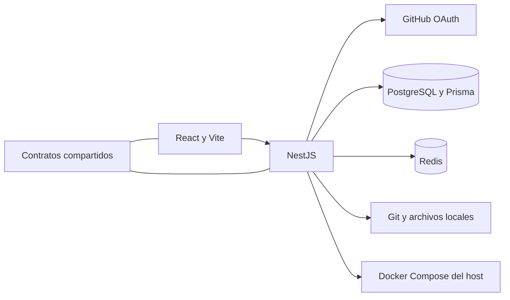

---
tags:
  - neoglito
  - documentacion
actualizado: 2026-10-10
tipo: documentacion-tecnica
---

# Arquitectura

El backend usa NestJS y TypeScript con separación entre presentación, aplicación, dominio e infraestructura. Las interfaces o puertos permiten conectar casos de uso con adaptadores de Prisma, Git, YAML, Redis y Docker. Esta estructura se aplica con distintos grados de separación: algunos servicios de aplicación utilizan Prisma directamente.

| Carpeta | Responsabilidad |
| --- | --- |
| `src/auth` | OAuth, JWT y vinculación GitHub |
| `src/project` | Crear, listar y editar proyectos |
| `src/repository` | Registro, listado GitHub y clonado |
| `src/analisys` | Análisis de proyectos; la carpeta conserva esta grafía |
| `src/deployment` | Preparación Compose y casos de uso de despliegue |
| `src/container` | Abstracción y adaptador del runtime Docker |
| `src/ports` | Reservas, sondas y clasificación |
| `src/shared` | Infraestructura y respuesta HTTP comunes |
| `src/startup` | Restauración de reservas al iniciar |
| `apps/web` | Interfaz React |
| `packages/shared` | Contratos TypeScript reutilizables |
| `prisma` | Schema dividido en modelos y migraciones |

`AppModule` conecta los módulos principales. `main.ts` carga `.env`, comprueba Docker, instala filtro e interceptor globales, habilita CORS con credenciales y expone Swagger en `/docs`.

Relacionadas: [[05 - API y contratos]], [[06 - Modelo de datos]], [[10 - Frontend]].

## Fuentes del repositorio

- [src/app.module.ts](file:///C:/Users/Uriel-Galvan/Documents/Proyectos%20Programacion/neoglito/src/app.module.ts)
- [src/main.ts](file:///C:/Users/Uriel-Galvan/Documents/Proyectos%20Programacion/neoglito/src/main.ts)
