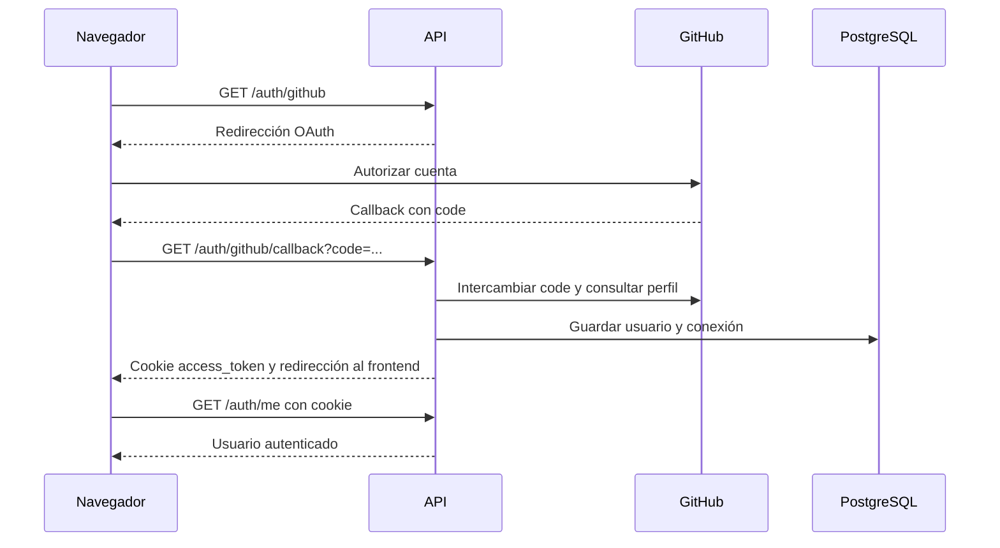

---
tags:
  - neoglito
  - documentacion
actualizado: 2026-10-10
tipo: documentacion-tecnica
---

# Autenticación

El inicio OAuth solicita `read:user user:email`. El callback obtiene el token y perfil de GitHub y emite un JWT para la aplicación. La cookie `access_token` es HttpOnly, SameSite `lax`, dura una hora y activa `secure` cuando `NODE_ENV` es `production`.

`JwtStrategy` acepta la cookie o `Authorization: Bearer <token>` y verifica expiración. Devuelve el usuario como `{ id, username }`. El cliente web usa `credentials: 'include'`; el backend permite credenciales para `FRONTEND_URL`.

Los tokens GitHub se cifran mediante AES-256-GCM con clave de 32 bytes, IV aleatorio y etiqueta de autenticación. El formato almacenado incluye versión `v1`. El clonado descifra el token cuando debe acceder al repositorio.

No todos los endpoints tienen guard: consulta la tabla de [[05 - API y contratos]]. Además, el modelo actual no relaciona proyectos con usuarios; consulta [[06 - Modelo de datos]].

## Fuentes del repositorio

- [src/auth/presentation/authentication.controller.ts](file:///C:/Users/Uriel-Galvan/Documents/Proyectos%20Programacion/neoglito/src/auth/presentation/authentication.controller.ts)
- [src/auth/infrastructure/passport/jwt.strategy.ts](file:///C:/Users/Uriel-Galvan/Documents/Proyectos%20Programacion/neoglito/src/auth/infrastructure/passport/jwt.strategy.ts)
- [src/shared/infrastructure/security/aes-256-gcm-encryption.service.ts](file:///C:/Users/Uriel-Galvan/Documents/Proyectos%20Programacion/neoglito/src/shared/infrastructure/security/aes-256-gcm-encryption.service.ts)
