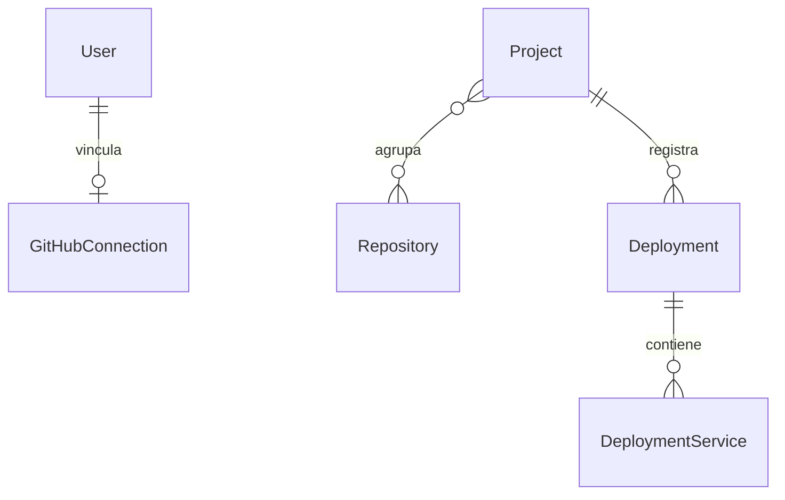

---
tags:
  - neoglito
  - documentacion
actualizado: 2026-10-10
tipo: documentacion-tecnica
---

# Modelo de datos

Prisma usa PostgreSQL. `schema.prisma` declara generador y proveedor; los modelos reales se encuentran en `prisma/models`. `PrismaService` utiliza `PrismaPg` y exige `DATABASE_URL`.

| Modelo | Campos y restricciones relevantes |
| --- | --- |
| `User` | id incremental, name, createdAt |
| `GitHubConnection` | userId único, githubId único, username, avatarUrl, tokens y vencimientos opcionales |
| `Project` | id incremental, name único, description, createdAt, updatedAt |
| `Repository` | id externo entero, name, gitUrl, cloneUrl único; relación muchos a muchos con proyectos |
| `Deployment` | UUID, projectId, composePath, status, createdAt, startedAt, finishedAt |
| `DeploymentService` | id de contenedor, composeServiceName, port, status, health, serviceType, lastObservedAt |

Eliminar un usuario elimina su conexión GitHub; eliminar un proyecto elimina sus despliegues; eliminar un despliegue elimina sus servicios mediante cascadas declaradas.

## Enumeraciones

- DeploymentStatus: `pending`, `building`, `starting`, `running`, `failed`, `stopping`, `stopped`.
- ContainerStatus: `created`, `running`, `paused`, `restarting`, `exited`, `dead`.
- ContainerHealth: `starting`, `healthy`, `unhealthy`, `none`.
- ServiceType: `BACKEND`, `FRONTEND`, `DATABASE`, `CACHE`, `MESSAGE_BROKER`, `WORKER`, `SCHEDULER`, `REVERSE_PROXY`, `UNKNOWN`.

`DeploymentService.port` almacena un entero por servicio. El valor `0` representa ausencia de publicación; el endpoint de puertos puede responder `null` cuando no hay asignación activa. No almacena todas las publicaciones posibles ni evidencia de clasificación.

> [!note] Alcance de usuarios
> `Project` no tiene userId ni relación con User. `PrismaProjectRepository.findAll()` lista todos los proyectos. Un guard JWT exige una sesión, pero no proporciona por sí mismo aislamiento de proyectos por usuario.

Relacionadas: [[04 - Autenticacion]], [[08 - Despliegues Docker]], [[09 - Puertos y clasificacion]].

## Fuentes del repositorio

- [prisma/models/user.prisma](file:///C:/Users/Uriel-Galvan/Documents/Proyectos%20Programacion/neoglito/prisma/models/user.prisma)
- [prisma/models/github-connection.prisma](file:///C:/Users/Uriel-Galvan/Documents/Proyectos%20Programacion/neoglito/prisma/models/github-connection.prisma)
- [prisma/models/project.prisma](file:///C:/Users/Uriel-Galvan/Documents/Proyectos%20Programacion/neoglito/prisma/models/project.prisma)
- [prisma/models/repository.prisma](file:///C:/Users/Uriel-Galvan/Documents/Proyectos%20Programacion/neoglito/prisma/models/repository.prisma)
- [prisma/models/deployment.prisma](file:///C:/Users/Uriel-Galvan/Documents/Proyectos%20Programacion/neoglito/prisma/models/deployment.prisma)
- [src/project/infrastructure/persistence/prisma-project.repository.ts](file:///C:/Users/Uriel-Galvan/Documents/Proyectos%20Programacion/neoglito/src/project/infrastructure/persistence/prisma-project.repository.ts)
