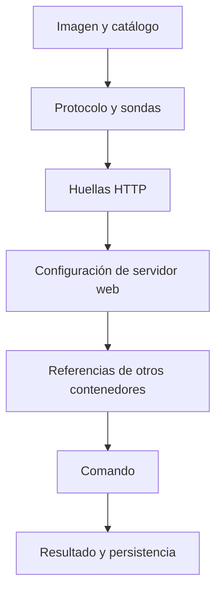

---
tags:
  - neoglito
  - documentacion
actualizado: 2026-10-10
tipo: documentacion-tecnica
---

# Puertos y clasificación

## Reservas Redis

`POST /port` valida puertos enteros de 1 a 65535 y crea una reserva provisional con propietario `draft:<projectId>:port:<port>`. Su TTL es **300 segundos**. Si está reservado o en uso, devuelve conflicto. `DELETE /port/:projectId/:port` libera únicamente la reserva provisional correspondiente.

Al desplegar, la reserva provisional pasa a propietarios del despliegue; los contenedores tienen sus reservas asociadas. `GET /port` devuelve un mapa de claves de propietario a claves de puerto; no devuelve una lista de todos los puertos libres del sistema.

En el arranque, `RestoreDeploymentPortReservationsService` consulta servicios persistidos `running`, `paused` o `restarting` con puerto mayor a cero y restaura las reservas en Redis. Si detecta conflictos, falla el bootstrap con un error.

`GET /deployment/:deploymentId/ports` lee asignaciones persistidas sin ejecutar Docker ni reservar puertos. Los despliegues detenidos/fallidos o servicios sin publicación devuelven `null`. La interfaz bloquea campos ya asignados; si la consulta falla ofrece reintentar.

## Clasificación de servicios

`POST /deployment/:deploymentId/classify` observa e inspecciona contenedores. Todos los servicios registrados deben seguir en `running`; no es obligatorio que publiquen puertos.

La cadena puede resolver antes de llegar al final. Los handlers pasan, acotan candidatos, resuelven o señalan conflicto. Los discriminadores solo se aplican cuando admiten todos los candidatos restantes.

Las sondas TCP/HTTP consultan puertos publicados usando `CONTAINER_PROBE_HOST`; la configuración se obtiene mediante Docker exec. Las referencias, aliases y variables ayudan a distinguir Redis como caché o broker. Comandos de tareas permiten distinguir worker y scheduler.

Un resultado `resolved` guarda su tipo; `ambiguous`, `conflict` y `unknown` guardan `UNKNOWN`. Candidatos y evidencia no se persisten. Un servicio sin puertos puede clasificarse por imagen, configuración, uso o comando.

Relacionadas: [[06 - Modelo de datos]], [[08 - Despliegues Docker]], [[12 - Diagnostico y limites]].

## Fuentes del repositorio

- [src/ports/infrastructure/classification/README.md](file:///C:/Users/Uriel-Galvan/Documents/Proyectos%20Programacion/neoglito/src/ports/infrastructure/classification/README.md)
- [src/ports/application/draft-port-owner.ts](file:///C:/Users/Uriel-Galvan/Documents/Proyectos%20Programacion/neoglito/src/ports/application/draft-port-owner.ts)
- [src/ports/infrastructure/reservations/redis-port-reservation.service.ts](file:///C:/Users/Uriel-Galvan/Documents/Proyectos%20Programacion/neoglito/src/ports/infrastructure/reservations/redis-port-reservation.service.ts)
- [src/startup/restore-deployment-port-reservations.service.ts](file:///C:/Users/Uriel-Galvan/Documents/Proyectos%20Programacion/neoglito/src/startup/restore-deployment-port-reservations.service.ts)
- [src/deployment/application/use-cases/get-deployment-ports.use-case.ts](file:///C:/Users/Uriel-Galvan/Documents/Proyectos%20Programacion/neoglito/src/deployment/application/use-cases/get-deployment-ports.use-case.ts)
