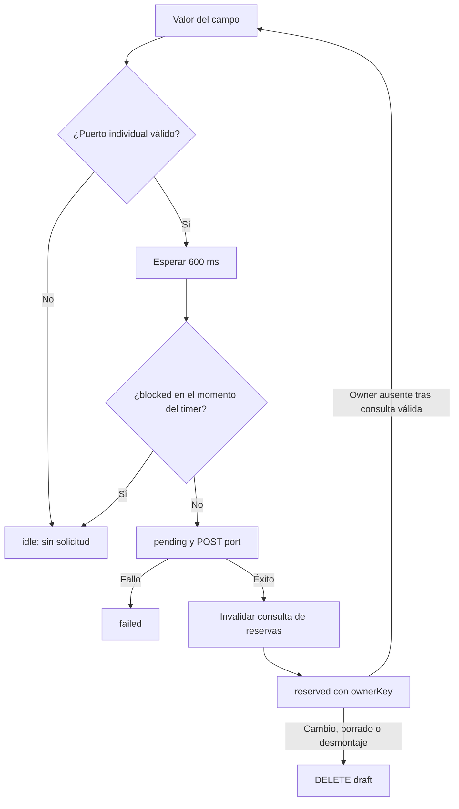

---
tags:
  - neoglito
  - ports
  - documentacion-tecnica
funcionalidad: ports
actualizado: 2026-10-10
---

# Ports · frontend y uso

## Consulta de reservas

portService llama GET /port, POST /port y DELETE /port/projectId/port con apiClient. usePorts usa TanStack Query con key ['ports'], staleTime 30 s, gcTime 5 min y refetchInterval 30 s. Una respuesta fallida hace que queryFn lance error. Expone reservedPorts ({} si no hay datos), loading/fetching/error y refresh.

parseReservations transforma ownerKey → portKey a filas `{port,owner}`. Reconoce owners de deployment y draft para mostrar mensajes; otros como IDs Docker se muestran directamente. checkPublishedPort valida número/rango 1..65535 y busca conflictos en esas filas; no consulta sockets.

Sus estados son empty, invalid, free y reserved con conflicts. free significa **sin reserva conocida en esa lista**, no disponibilidad del sistema operativo ni del daemon. La lectura puede estar desactualizada entre refetches.

## Hook de reserva provisional

usePortReservation(projectId,value,blocked) usa parseSinglePort: solo dígitos, entero entre 1 y 65535. No reserva rangos. Mantiene resultado asociado a key projectId:port, con estados idle, pending, reserved (ownerKey) y failed (message).



El debounce espera 600 ms sin cambio de key. El effect usa una ref para leer blocked al dispararse; no depende directamente de blocked para reinstalar el timer. Cambiar únicamente blocked no garantiza por sí solo un nuevo intento si el timer anterior ya terminó bloqueado.

Al reservar con éxito espera invalidación/refetch antes de publicar reserved, para no tratar la lista antigua como expiración. Si la petición termina después del desmontaje o cambio de valor, libera la reserva recién creada. Al limpiar el effect cancela el timer y libera si había reservado.

Si está reserved, la consulta terminó sin error y su ownerKey desapareció, descarta ese resultado e incrementa attempt para intentarlo de nuevo. No renueva periódicamente un TTL que aún existe. Un POST fallido publica failed; no hay un retry específico del hook para ese conflicto sin cambios que vuelvan a ejecutar el efecto.

Como owner depende solo de proyecto/puerto, dos pestañas o campos con la misma identidad no tienen owners independientes. Una liberación de uno puede afectar el draft compartido. La expiración de servidor limita la vida si el frontend no puede liberar.

## Campo DeployPortField

Si recibe assignedPort, muestra el valor deshabilitado y pasa null al hook para evitar reservar de nuevo. disabled o !canCheckPorts también bloquean chequeos y pasan null. Mientras pending el input es readOnly y muestra estado de carga.

Si no hay asignación, compara publishedPort con reservas y usa check.status reserved como blocked. El componente no filtra protocolos para el hook: un número individual en un mapping UDP también puede solicitar una **reserva TCP**. El backend de Ports no tiene campo protocol. Los rangos se pueden comprobar visualmente, pero el hook no los reserva.

El mensaje free se presenta como “Puerto no reservado por Neoglito”. Que el input muestre un check verde tras reserve confirma la reserva provisional, no que el servicio haya arrancado.

## Asignaciones de despliegues

ProjectDeployTab consulta asignaciones al abrir y no reintenta automáticamente esa query (retry false). Mientras carga o falla, el detalle puede bloquear campos y ofrece reintentar. assignedDeploymentPort asocia archivo/servicio y solo infiere el único TCP one-to-one de ese servicio.

Al desplegar, el backend libera el draft y crea hold. El frontend envía mirrorPorts true, con sus restricciones propias: que un rango/UDP pueda representarse en el formulario no implica que ese modo lo admita. Después invalida consultas de puertos/reservas. Ver [[Deployment - Modo espejo]].

## Consumo interno

```typescript
// En un proveedor que ya inyecta PORT_RESERVATION_PORT:
const held = await this.reservations.holdPort(8080, 'deployment:id:port:8080');
if (!held) throw new Error('No se pudo retener el puerto');
await held.handoff();
// El coordinador debe arrancar el runtime y gestionar cleanup/transferencia.
```

El contrato no guarda Prisma ni inicia Docker automáticamente. Para clasificar, proporcionar el conjunto completo de ContainerInspection al token CONTAINER_CLASSIFICATION_PORT; así el discriminador de consumidores tiene contexto. El flujo público recomendado es classify del deployment existente.

Volver a [[Ports - Indice]].

## Fuentes del código

- [apps/web/src/features/ports/port.service.ts](file:///C:/Users/Uriel-Galvan/Documents/Proyectos%20Programacion/neoglito/apps/web/src/features/ports/port.service.ts)
- [apps/web/src/features/ports/port-reservations.ts](file:///C:/Users/Uriel-Galvan/Documents/Proyectos%20Programacion/neoglito/apps/web/src/features/ports/port-reservations.ts)
- [apps/web/src/features/ports/use-ports.ts](file:///C:/Users/Uriel-Galvan/Documents/Proyectos%20Programacion/neoglito/apps/web/src/features/ports/use-ports.ts)
- [apps/web/src/features/ports/use-port-reservation.ts](file:///C:/Users/Uriel-Galvan/Documents/Proyectos%20Programacion/neoglito/apps/web/src/features/ports/use-port-reservation.ts)
- [apps/web/src/features/projects/components/deploy/deploy-port-field.tsx](file:///C:/Users/Uriel-Galvan/Documents/Proyectos%20Programacion/neoglito/apps/web/src/features/projects/components/deploy/deploy-port-field.tsx)
- [apps/web/src/features/projects/components/deploy/project-deploy-tab.tsx](file:///C:/Users/Uriel-Galvan/Documents/Proyectos%20Programacion/neoglito/apps/web/src/features/projects/components/deploy/project-deploy-tab.tsx)
- [apps/web/src/features/projects/deployment-assigned-ports.ts](file:///C:/Users/Uriel-Galvan/Documents/Proyectos%20Programacion/neoglito/apps/web/src/features/projects/deployment-assigned-ports.ts)
- [src/ports/application/port-reservation.port.ts](file:///C:/Users/Uriel-Galvan/Documents/Proyectos%20Programacion/neoglito/src/ports/application/port-reservation.port.ts)
