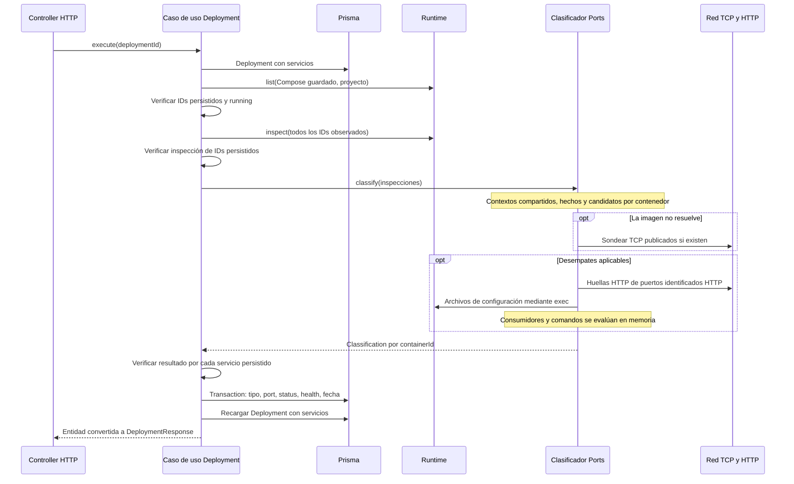
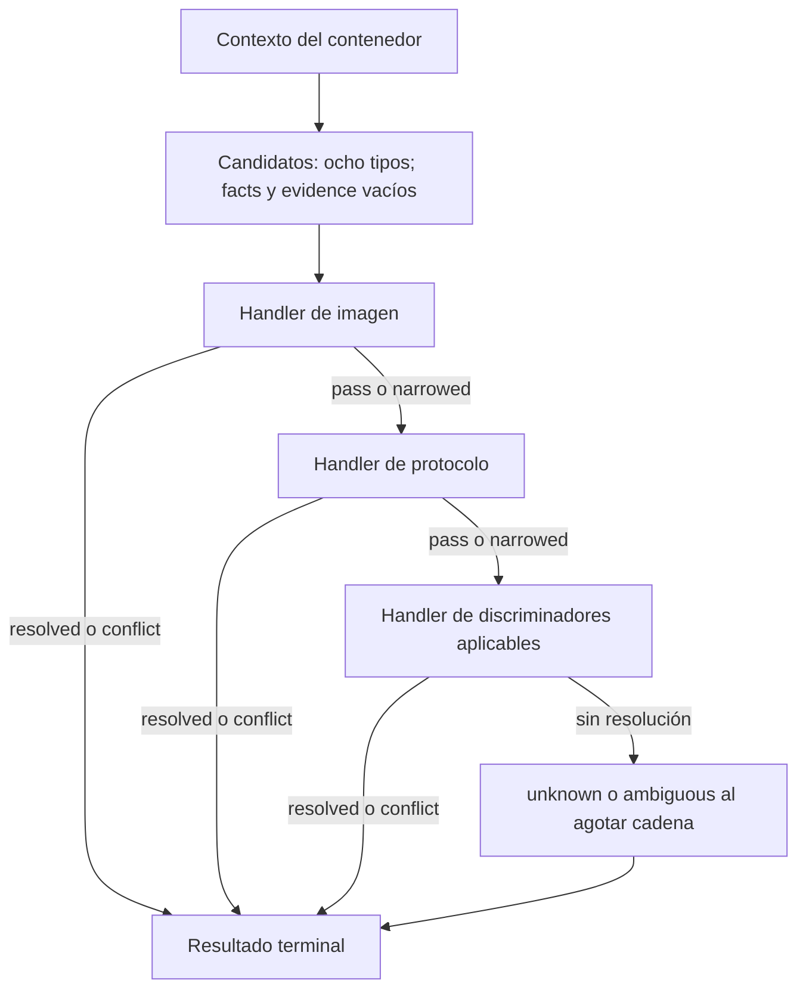

---
tags:
  - neoglito
  - ports
  - documentacion-tecnica
funcionalidad: ports
actualizado: 2026-10-10
---

# Ports · pipeline: recorrido completo

## Entrada y salida reales

El pipeline se activa con POST /deployment/:deploymentId/classify, protegido por JWT. El controlador llama ClassifyDeploymentServicesUseCase. Esta operación no crea contenedores ni reserva puertos; observa un despliegue existente y actualiza sus filas.

## 1. Precondiciones del caso de uso

Busca Deployment con servicios; inexistente → 404 y servicios vacíos → 409. list usa composePath guardado y el nombre independiente si corresponde a un archivo generado actual. Cada ID persistido debe aparecer y tener status running. No exige health healthy ni publicación de puertos.

Si Docker recreó contenedores con otros IDs, rechaza aunque tengan el mismo nombre Compose. No incorpora filas nuevas automáticamente. Si list observa contenedores adicionales, también los inspecciona para enriquecer el contexto; solo actualiza filas ya persistidas.

Errores de list/inspect se convierten en 409. Exige que todas las filas persistidas estén entre las inspecciones recibidas. No espera readiness ni reintenta estas precondiciones.

## 2. Preparación del contexto

ContainerClassificationService añade host = CONTAINER_PROBE_HOST o 127.0.0.1 a cada inspección y renombra containerId como id. Conserva image, aliases, ports, command y env. No hace DNS de aliases para sondear: todos los puertos se consultan sobre ese host configurado.

Construye una cadena con imagen, protocolo y un handler de discriminadores. El discriminador de uso recibe todos los contextos, incluso los que después tengan una clasificación UNKNOWN. No necesita esperar a la clasificación de los consumidores para leer sus variables.

## 3. Ejecución por contenedor

La cadena es secuencial dentro de cada contexto. Los contextos se clasifican mediante Promise.all: varios contenedores pueden abrir sockets/ejecutar lecturas a la vez. Dentro de probeContainer también hay paralelismo entre puertos; los intentos de protocolo de un puerto son secuenciales.

No hay un límite explícito de concurrencia, caché de resultados entre requests ni timeout global del pipeline. Los caches internos de huellas HTTP solo viven durante fingerprintPort. Los candidatos, facts y evidence son nuevos por contenedor y no se comparten como estado mutable.

## 4. Persistencia

El caso de uso exige un resultado para cada ID guardado. Si kind resolved, guarda type, incluso si es UNKNOWN explícito. Para ambiguous, conflict y unknown guarda UNKNOWN. No transforma un conflict de clasificación en error HTTP: puede terminar con éxito y UNKNOWN.

Actualiza en una transacción serviceType, el único port de list, status, health y lastObservedAt común. No guarda la lista completa de inspect ni la evidencia. Después recarga el despliegue y responde. Un error del clasificador fuera de catches o de Prisma puede resultar en 500; un rechazo de Promise.all no cancela los I/O ya iniciados.

## Qué significa el resultado

Una resolución temprana por catálogo puede omitir todas las comprobaciones de red. Un UNKNOWN guardado puede corresponder a una herramienta conocida, falta de evidencia, múltiples roles o evidencia incompatible. El pipeline clasifica por prioridad de reglas; no calcula puntuaciones ni confirma exhaustivamente todas las señales.

Continuar en [[Ports - Pipeline candidatos y veredictos]] y [[Ports - Pipeline ejemplos paso a paso]].

Volver a [[Ports - Indice]].

## Fuentes del código

- [src/deployment/presentation/deployment.controller.ts](file:///C:/Users/Uriel-Galvan/Documents/Proyectos%20Programacion/neoglito/src/deployment/presentation/deployment.controller.ts)
- [src/deployment/application/use-cases/classify-deployment-services.use-case.ts](file:///C:/Users/Uriel-Galvan/Documents/Proyectos%20Programacion/neoglito/src/deployment/application/use-cases/classify-deployment-services.use-case.ts)
- [src/ports/infrastructure/classification/container-classification.service.ts](file:///C:/Users/Uriel-Galvan/Documents/Proyectos%20Programacion/neoglito/src/ports/infrastructure/classification/container-classification.service.ts)
- [src/ports/infrastructure/classification/classification.ts](file:///C:/Users/Uriel-Galvan/Documents/Proyectos%20Programacion/neoglito/src/ports/infrastructure/classification/classification.ts)
