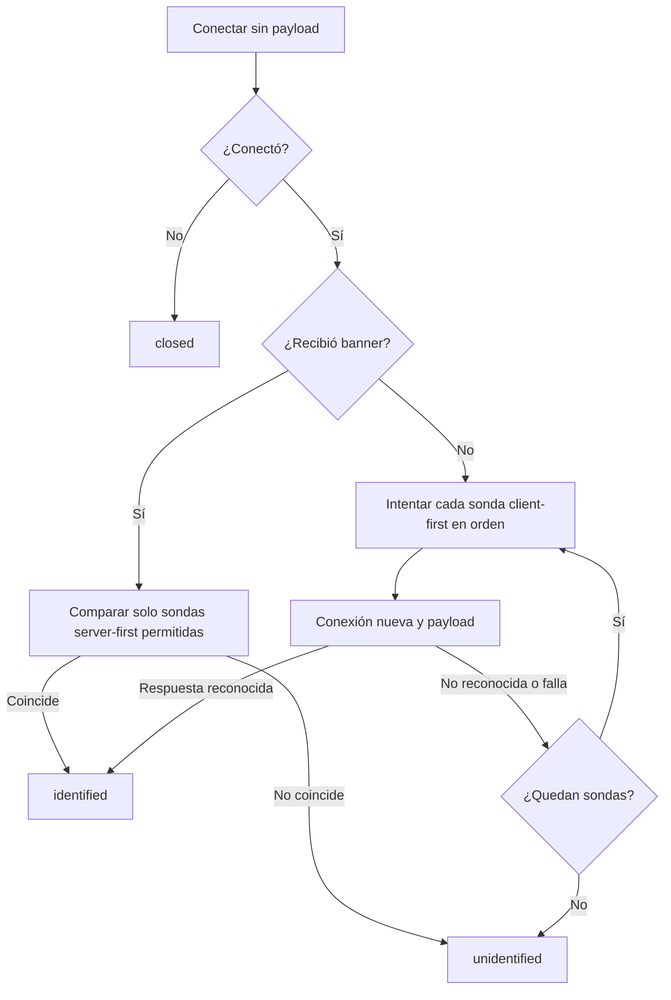

---
tags:
  - neoglito
  - ports
  - documentacion-tecnica
funcionalidad: ports
actualizado: 2026-10-10
---

# Ports · sondas TCP y mensajes

## Capas

protocol-probes.ts define funciones puras: qué Buffer enviar y cómo reconocer otro Buffer. port-identification.ts realiza el I/O con node:net. TcpContainerProbeService selecciona orden y host; no escribe Redis ni Prisma.

Orden recibido por identifyPort: mysql, nats, postgres, mongo, resp, memcached, amqp, kafka, mqtt y http. MySQL/NATS esperan banner; las demás hablan primero. HTTP va al final entre las peticiones porque es una respuesta genérica.

## Algoritmo de un puerto

exchange crea un socket por intento. Antes de connect configura 1000 ms; tras connect espera 300 ms para banner o 1000 ms para respuesta. Si hay payload lo escribe. El primer evento data termina el intercambio y destruye el socket. timeout/error/close también lo terminan, protegido por settled para resolver una sola vez.

Si conecta pero no recibe datos, devuelve connected true con Buffer vacío. Si nunca conecta devuelve connected false. Después de una apertura exitosa, fallos de intentos posteriores no cambian el resultado a closed: termina unidentified si nadie reconoce.

## Mensajes y reglas de reconocimiento

| Protocolo | Mensaje / condición | Reconocimiento implementado |
| --- | --- | --- |
| mysql | Sin payload; servidor presenta banner | Más de 4 bytes, secuencia byte 3 igual a 0, byte 4 igual a 0x0a o 0xff |
| nats | Sin payload | Texto empieza `INFO {` |
| postgres | SSLRequest: 8 bytes, código 80877103 | Exactamente un byte S (0x53) o N (0x4e) |
| mongo | OP_MSG 2013 con hello:1 y $db admin; requestId 42 | Al menos 16 bytes, responseTo 42 y opcode 2013 |
| resp | `PING\r\n` | Prefijo +PONG o error RESP con mayúsculas y espacio, p. ej. -NOAUTH |
| memcached | `version\r\n` | Prefijo VERSION seguido de espacio |
| amqp | Header AMQP 0-0-9-1 | Frame tipo 1/canal 0 con al menos 7 bytes, o prefijo AMQP |
| kafka | ApiVersions v0, correlationId 42, clientId nulo | Al menos 8 bytes y correlationId 42 en offset 4 |
| mqtt | CONNECT 3.1.1, clean session, clientId vacío | Al menos 4 bytes, primeros bytes 0x20 0x02 (CONNACK) |
| http | HEAD / HTTP/1.1 con Host, User-Agent hub-classifier y Connection close | Línea comienza HTTP/versión y código de tres dígitos |

Las reglas no completan autenticación ni sesiones. Un error reconocible puede bastar para identificar protocolo, como RESP que exige contraseña. El objetivo es reconocer la tecnología, no validar credenciales o disponibilidad funcional completa.

## Agregación por contenedor

probeContainer sondea todos los números en paralelo mediante Promise.all. No deduplica ni valida los números recibidos por sí mismo; normalmente vienen normalizados de inspect. Retorna PortResult en el orden de entrada.

- Si todos son closed, outcome no_listeners. Una lista vacía también cumple every y produciría no_listeners si se llama directamente; el handler de protocolo evita esa llamada en el flujo normal sin publicaciones.
- Si no hay protocolos identificados pero algún puerto conectó, outcome unidentified.
- Si hay alguno, outcome identified con protocolos deduplicados, aunque otros estén closed/unidentified.

## Coste y límites

Un puerto silencioso puede abrir nueve conexiones: apertura más ocho sondas client-first. Por contenedor se ejecutan en paralelo los puertos y por clasificación los contenedores; no hay un pool que limite el fan-out. Los tiempos son por socket, no una fecha límite de toda la petición.

Solo lee el primer bloque TCP, sin reensamblar mensajes fragmentados. Una firma que llegue dividida puede no reconocerse. Tampoco negocia TLS/HTTPS ni usa UDP. El SSLRequest de PostgreSQL solo identifica el byte de respuesta; no inicia TLS después.

Un banner que no coincide impide los intentos client-first de ese puerto. Los timeouts/errores de conexión no distinguen firewall, servicio ausente, DNS incorrecto o red inaccesible. Las sondas envían tráfico de protocolo al servicio; no son un escaneo pasivo de metadatos Docker.

CONTAINER_PROBE_HOST debe permitir alcanzar los puertos **publicados**, no necesariamente los internos. La dirección host_ip original no se preserva en la lista de inspect, por lo que un único host configurado puede no alcanzar todos los bindings.

Volver a [[Ports - Indice]].

## Fuentes del código

- [src/ports/infrastructure/probing/protocol-probes.ts](file:///C:/Users/Uriel-Galvan/Documents/Proyectos%20Programacion/neoglito/src/ports/infrastructure/probing/protocol-probes.ts)
- [src/ports/infrastructure/probing/port-identification.ts](file:///C:/Users/Uriel-Galvan/Documents/Proyectos%20Programacion/neoglito/src/ports/infrastructure/probing/port-identification.ts)
- [src/ports/infrastructure/probing/tcp-container-probe.service.ts](file:///C:/Users/Uriel-Galvan/Documents/Proyectos%20Programacion/neoglito/src/ports/infrastructure/probing/tcp-container-probe.service.ts)
- [src/container/application/container-runtime.port.ts](file:///C:/Users/Uriel-Galvan/Documents/Proyectos%20Programacion/neoglito/src/container/application/container-runtime.port.ts)
