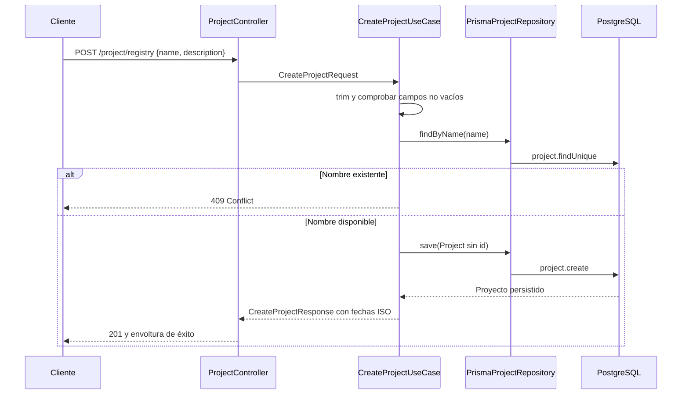
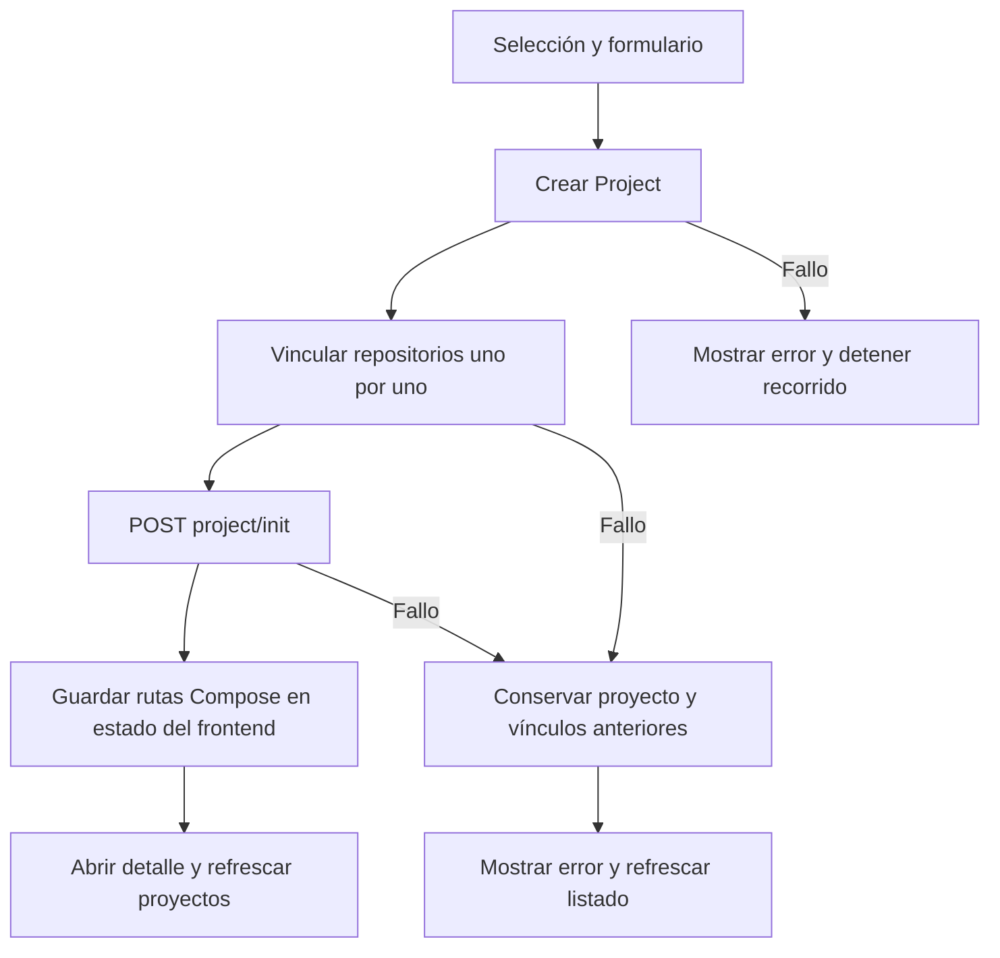

---
tags:
  - neoglito
  - project
  - documentacion-tecnica
funcionalidad: Project
actualizado: 2026-10-10
---

# Project · flujo

## Crear mediante la API

El registro no recibe repositorios ni identidad del usuario. Un consumidor de API puede crear un proyecto sin repositorios. Crear la entidad tampoco clona archivos, descubre Compose, reserva puertos ni arranca contenedores.

## Crear desde el frontend

`useProjectCreation` requiere repositorios seleccionados y coordina varios requests:

No hay una transacción que abarque estas solicitudes ni rollback compensatorio. Si el proyecto se crea y falla el segundo vínculo, el proyecto y el primer vínculo permanecen. [[Project - Repositorios e inicializacion]] describe cómo continuar desde ese estado.

## Consultar

`GET /project` pasa por `JwtAuthGuard`, `GetProjectsUseCase` y `findAll`. Prisma incluye repositorios y ordena por `updatedAt` descendente. El caso de uso transforma fechas a ISO y el interceptor envuelve el array. No recibe `userId`, paginación ni filtro. Es una consulta a persistencia; no consulta GitHub ni Docker.

## Editar

1. El controlador parsea `:id` con `ParseIntPipe` y recibe ambos campos.
2. `UpdateProjectUseCase` recorta y valida nombre y descripción.
3. Busca el proyecto; si no existe, el adaptador lanza 404.
4. Busca el nombre y permite conservarlo si pertenece al mismo id; si pertenece a otro proyecto, lanza 409.
5. Guarda una entidad con el mismo id mediante `project.update`, que modifica nombre y descripción e incluye repositorios.
6. Devuelve el proyecto con fechas ISO y repositorios resumidos. Prisma administra el nuevo `updatedAt`.

La validación del cuerpo ocurre antes de comprobar existencia: un id inexistente y un nombre vacío producen 400, no 404. Las operaciones de lectura y escritura no se agrupan en una transacción, por lo que una modificación concurrente puede cambiar el resultado entre ambas.

Volver a [[Project - Indice]].

## Fuentes del código

- [src/project/application/use-cases/create-project.use-case.ts](file:///C:/Users/Uriel-Galvan/Documents/Proyectos%20Programacion/neoglito/src/project/application/use-cases/create-project.use-case.ts)
- [src/project/application/use-cases/get-projects.use-case.ts](file:///C:/Users/Uriel-Galvan/Documents/Proyectos%20Programacion/neoglito/src/project/application/use-cases/get-projects.use-case.ts)
- [src/project/application/use-cases/update-project.use-case.ts](file:///C:/Users/Uriel-Galvan/Documents/Proyectos%20Programacion/neoglito/src/project/application/use-cases/update-project.use-case.ts)
- [apps/web/src/features/projects/hooks/use-project-creation.ts](file:///C:/Users/Uriel-Galvan/Documents/Proyectos%20Programacion/neoglito/apps/web/src/features/projects/hooks/use-project-creation.ts)
