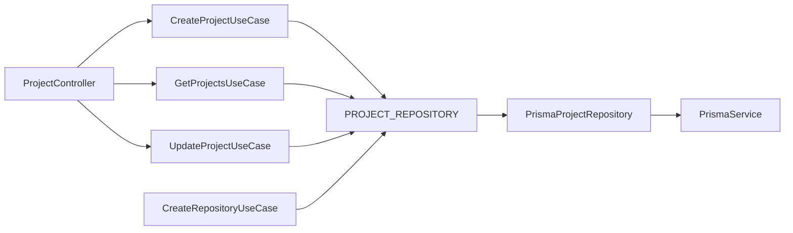

---
tags:
  - neoglito
  - project
  - documentacion-tecnica
funcionalidad: Project
actualizado: 2026-10-10
---

# Project · implementación y contratos

## Inyección de dependencias

`AppModule` importa `ProjectModule`. Este importa `AuthModule` y `PrismaModule`, registra `ProjectController` y proporciona los tres casos de uso. El token `PROJECT_REPOSITORY = Symbol("PROJECT_REPOSITORY")` se asocia mediante `useClass` a `PrismaProjectRepository` y se exporta.

`RepositoryModule` importa ProjectModule para utilizar ese token al comprobar que existe el proyecto de un vínculo. ProjectModule no importa RepositoryModule: la dependencia entre módulos en ese recorrido va de Repository hacia Project.

## Entidad de dominio

| Campo | Tipo | Significado |
|---|---|---|
| id | number o undefined | Undefined identifica una entidad nueva para `save` |
| name, description | string | Metadatos del proyecto |
| createdAt, updatedAt | Date | Fechas internas |
| repositories | ProjectRepositorySummary[] | Resúmenes `{id, name}`, por defecto array vacío |

El constructor asigna campos readonly, sin métodos, validación ni eventos. La entidad no contiene despliegues ni usuario, aunque Prisma tiene relación con Deployment.

## Contrato del repositorio

| Método | Retorno | Comportamiento del adaptador actual |
|---|---|---|
| save(project) | Promise de Project | Create si id es undefined; update en cualquier otro caso |
| findById(id) | Promise de Project | Lanza NotFoundException si falta |
| findByName(name) | Promise de Project o null | Consulta exacta por campo único |
| findAll() | Promise de Project[] | Incluye repositorios y ordena por updatedAt descendente |

La firma de `findById` no permite null: el consumidor depende de la excepción para el caso inexistente. El puerto también acopla indirectamente esa semántica HTTP porque el adaptador usa una excepción de Nest.

## Casos de uso y DTO

`CreateProjectUseCase.execute(request)` recibe la clase local `CreateProjectRequest`, con name y description readonly, compatible con el contrato compartido. `GetProjectsUseCase.execute()` no tiene parámetros. `UpdateProjectUseCase.execute(id, name, description)` recibe argumentos separados; no hay una clase request local para editar.

Los DTO implementan los tipos de `@neoglito/shared/repository` y solo usan `ApiProperty`. Estos decoradores describen Swagger; no validan tipos durante el request. Tampoco existe ValidationPipe global en main. La validación efectiva está en los casos de uso mediante `request.name?.trim()` y `description?.trim()`.

Esto detecta null, undefined, vacío y espacios; un número u objeto no garantiza 400 porque puede provocar un TypeError al llamar trim. No hay límite de longitud, regex de nombre ni conversión automática de valores.

## Respuestas

`CreateProjectResponse` tiene id, name, description, createdAt y updatedAt. `ProjectResponse` añade repositories con `{id, name}`. No contiene cloneUrl, gitUrl ni estados Docker. Las fechas públicas son strings ISO; las internas son Date.

Los casos de uso verifican que el repositorio devolvió un id. Si falta, lanzan Error, que el filtro global traduce a 500. Los contratos compartidos se ubican en `packages/shared/src/repository`, aun siendo contratos de proyectos.

Volver a [[Project - Indice]].

## Fuentes del código

- [src/project/project.module.ts](file:///C:/Users/Uriel-Galvan/Documents/Proyectos%20Programacion/neoglito/src/project/project.module.ts)
- [src/project/domain/entities/project.entity.ts](file:///C:/Users/Uriel-Galvan/Documents/Proyectos%20Programacion/neoglito/src/project/domain/entities/project.entity.ts)
- [src/project/domain/entities/project.repository.ts](file:///C:/Users/Uriel-Galvan/Documents/Proyectos%20Programacion/neoglito/src/project/domain/entities/project.repository.ts)
- [src/project/application/dto/create-project.dto.ts](file:///C:/Users/Uriel-Galvan/Documents/Proyectos%20Programacion/neoglito/src/project/application/dto/create-project.dto.ts)
- [src/project/application/dto/update-project.dto.ts](file:///C:/Users/Uriel-Galvan/Documents/Proyectos%20Programacion/neoglito/src/project/application/dto/update-project.dto.ts)
- [src/repository/repository.module.ts](file:///C:/Users/Uriel-Galvan/Documents/Proyectos%20Programacion/neoglito/src/repository/repository.module.ts)
- [packages/shared/src/repository/responses/project.response.ts](file:///C:/Users/Uriel-Galvan/Documents/Proyectos%20Programacion/neoglito/packages/shared/src/repository/responses/project.response.ts)
- [src/main.ts](file:///C:/Users/Uriel-Galvan/Documents/Proyectos%20Programacion/neoglito/src/main.ts)
