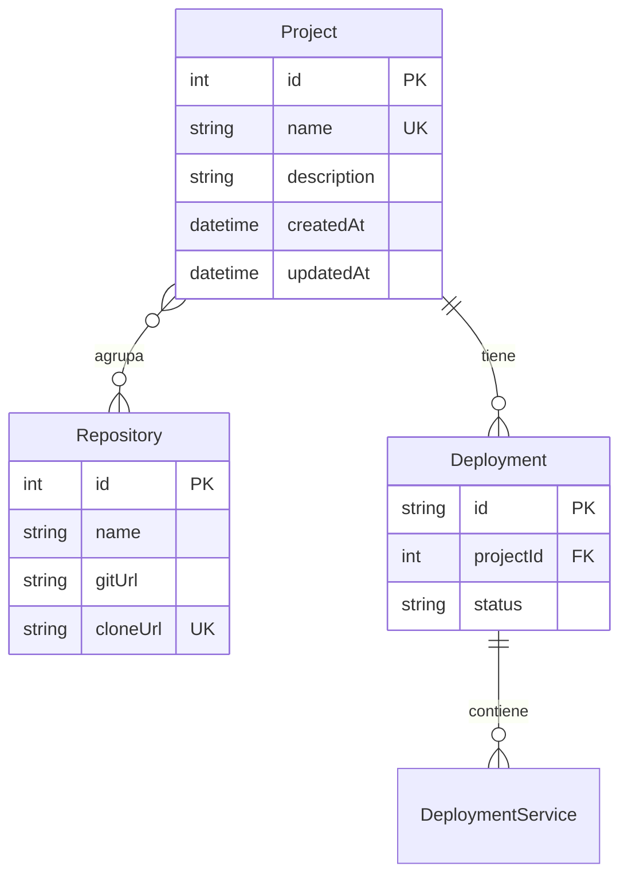

---
tags:
  - neoglito
  - project
  - documentacion-tecnica
funcionalidad: Project
actualizado: 2026-10-10
---

# Project · ORM y relaciones

## Modelo actual

```prisma
model Project {
  id           Int          @id @default(autoincrement())
  name         String       @unique
  description  String
  createdAt    DateTime     @default(now())
  updatedAt    DateTime     @updatedAt
  repositories Repository[]
  deployments  Deployment[]
}
```

La fuente del modelo es `prisma/models/project.prisma`. El datasource declara PostgreSQL. Project no tiene `userId`, propietario, estado activo ni ruta de clonación. El id es numérico autoincremental; los despliegues tienen identificadores UUID separados.



Repository declara `projects Project[]`, de modo que el esquema actual expresa muchos a muchos implícitos: un repositorio puede estar en varios proyectos. Su id se suministra desde el registro, no se autogenera en el modelo actual. `cloneUrl` es único globalmente.

Deployment posee `projectId` con eliminación en cascada. Eso expresa una acción de base de datos; no supone ejecutar Docker down, liberar Redis ni borrar clones. Project no ofrece endpoint de eliminación.

## Consultas del adaptador

| Operación | Prisma | Relaciones incluidas |
|---|---|---|
| Guardar entidad nueva | project.create con name, description y ambas fechas | Ninguna |
| Guardar entidad con id | project.update where id, data name y description | repositories: true |
| Buscar id | project.findUnique where id | Ninguna |
| Buscar nombre | project.findUnique where name | Ninguna |
| Listar | project.findMany, orderBy updatedAt desc | repositories: true |

`toDomain` transforma los repositorios incluidos a `{id, name}`. Si no se incluyeron, asigna `[]`. Por ello `findById` y `findByName` devuelven una entidad con array vacío aunque existan vínculos; no sirve inferir ausencia de repositorios a partir de esas consultas. Listado y actualización sí devuelven vínculos.

El create escribe explícitamente el mismo `new Date()` para createdAt y updatedAt. En el update, las fechas del objeto de dominio no se envían: `createdAt` permanece y `@updatedAt` gestiona el timestamp de la modificación. Asociar un repositorio mediante Repository no actualiza explícitamente Project.updatedAt; no debe interpretarse el orden del listado como actividad de despliegues o cambios en vínculos.

## Unicidad y concurrencia

El caso de uso consulta primero el nombre para ofrecer 409. El índice único sigue siendo la garantía final. Dos requests pueden leer que no existe y competir en create; el adaptador no traduce el error de unicidad de Prisma a ConflictException, así que la carrera puede terminar en 500.

La búsqueda no aplica lowerCase ni modo insensible a mayúsculas. La interfaz compara trim y lowerCase, mientras que backend consulta la cadena recortada. No debe asumir que la validación visual y la igualdad de la base de datos son idénticas.

## Diferencia con migraciones versionadas

La migración inicial `20260922132357` crea Repository con projectId, sshPrivateKey y otros campos históricos, con relación uno a muchos y unicidad `(projectId, cloneUrl)`. El esquema actual declara name, gitUrl y relación muchos a muchos, con cloneUrl único.

En las migraciones SQL revisadas no se encontró la conversión que crea la relación implícita muchos a muchos ni estos cambios de Repository. Es una diferencia entre archivos versionados, **no una comprobación de la base de datos instalada**. No se ejecutó migrate, db push ni introspección. Si un entorno construido solo con esas migraciones falla al incluir repositorios, comprobar primero esa diferencia y el cliente generado.

Volver a [[Project - Indice]].

## Fuentes del código

- [prisma/models/project.prisma](file:///C:/Users/Uriel-Galvan/Documents/Proyectos%20Programacion/neoglito/prisma/models/project.prisma)
- [prisma/models/repository.prisma](file:///C:/Users/Uriel-Galvan/Documents/Proyectos%20Programacion/neoglito/prisma/models/repository.prisma)
- [prisma/models/deployment.prisma](file:///C:/Users/Uriel-Galvan/Documents/Proyectos%20Programacion/neoglito/prisma/models/deployment.prisma)
- [prisma/schema.prisma](file:///C:/Users/Uriel-Galvan/Documents/Proyectos%20Programacion/neoglito/prisma/schema.prisma)
- [prisma/migrations/20260922132357/migration.sql](file:///C:/Users/Uriel-Galvan/Documents/Proyectos%20Programacion/neoglito/prisma/migrations/20260922132357/migration.sql)
- [src/project/infrastructure/persistence/prisma-project.repository.ts](file:///C:/Users/Uriel-Galvan/Documents/Proyectos%20Programacion/neoglito/src/project/infrastructure/persistence/prisma-project.repository.ts)
