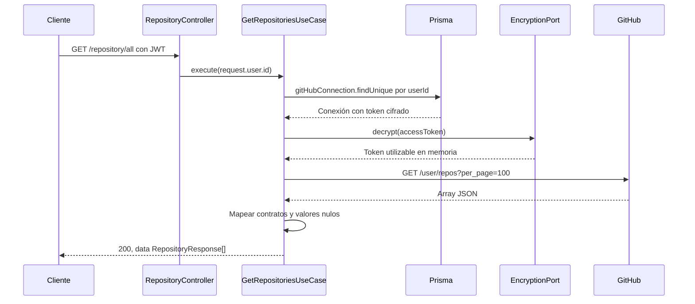
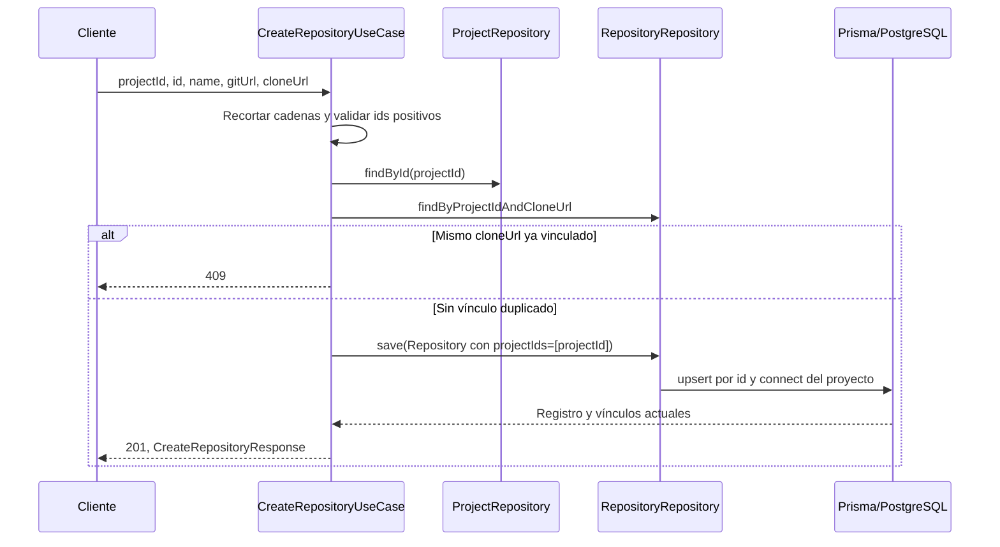
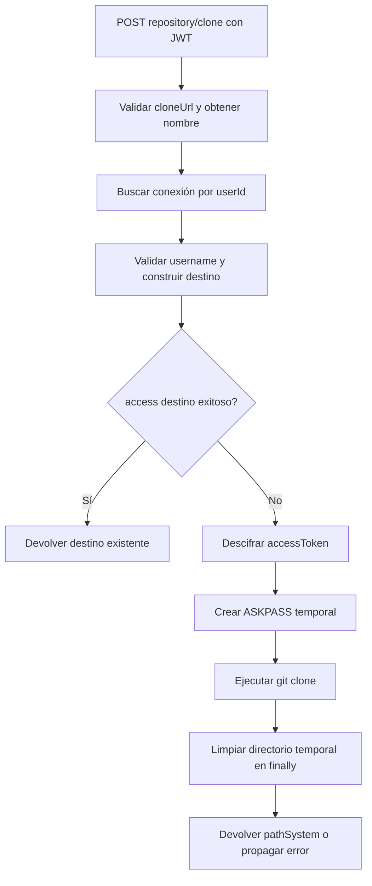

---
tags:
  - neoglito
  - repository
  - documentacion-tecnica
funcionalidad: Repository
actualizado: 2026-10-10
---

# Repository · flujos

## Listar repositorios remotos

Si falta conexión, se devuelve 404 antes del descifrado. Si GitHub responde un estado no exitoso, se devuelve 502. El listado no lee la tabla Repository ni sincroniza sus registros. El JWT identifica al usuario local; el token descifrado es el que se envía a GitHub.

## Registrar y vincular

No se hace una consulta GitHub para validar que el id o las URLs correspondan al usuario. El request se limita a metadatos y vínculo. Un id ya existente puede actualizar su nombre y URLs globalmente, además de agregar el proyecto recibido.

## Clonar o reutilizar

La conexión se exige incluso si el destino ya existe. En cambio, el token solo se descifra cuando no se puede acceder al destino. No hay lectura de Repository ni Project en este caso de uso.

## Uso desde análisis

ProjectAnalysisService carga un proyecto con repositories desde Prisma y llama `CloneRepositoryUseCase.execute(userId, {cloneUrl})` para cada vínculo mediante Promise.all. Luego busca y analiza Compose bajo las rutas obtenidas. Un fallo no cancela automáticamente las clonaciones restantes ni borra las que ya terminaron. [[Analisis - Flujo]] describe el recorrido posterior.

Volver a [[Repository - Indice]].

## Fuentes del código

- [src/repository/application/use-cases/repository/get-repositories.use-case.ts](file:///C:/Users/Uriel-Galvan/Documents/Proyectos%20Programacion/neoglito/src/repository/application/use-cases/repository/get-repositories.use-case.ts)
- [src/repository/application/use-cases/repository/create-repository.use-case.ts](file:///C:/Users/Uriel-Galvan/Documents/Proyectos%20Programacion/neoglito/src/repository/application/use-cases/repository/create-repository.use-case.ts)
- [src/repository/application/use-cases/repository/clone-repository.use-case.ts](file:///C:/Users/Uriel-Galvan/Documents/Proyectos%20Programacion/neoglito/src/repository/application/use-cases/repository/clone-repository.use-case.ts)
- [src/analisys/application/project-analysis.service.ts](file:///C:/Users/Uriel-Galvan/Documents/Proyectos%20Programacion/neoglito/src/analisys/application/project-analysis.service.ts)
