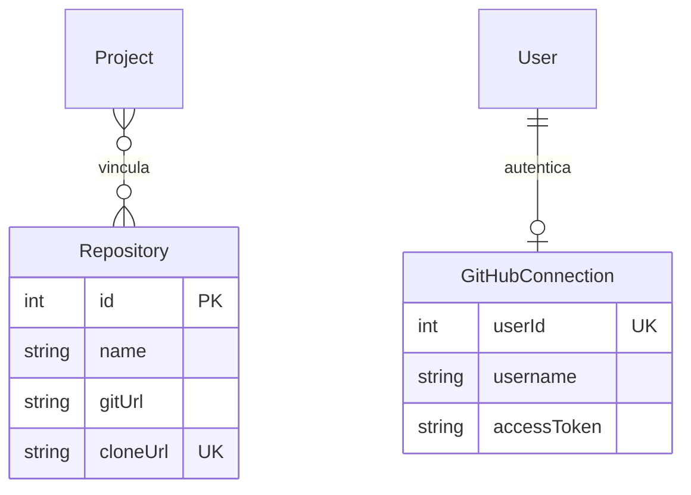

---
tags:
  - neoglito
  - repository
  - documentacion-tecnica
funcionalidad: Repository
actualizado: 2026-10-10
---

# Repository · ORM y vinculación

## Modelo actual

```prisma
model Repository {
  id       Int       @id
  name     String
  gitUrl   String
  cloneUrl String    @unique
  projects Project[]
}
```

El id se suministra desde el request, habitualmente el id de GitHub. No tiene default autoincrement. cloneUrl tiene unicidad global. No hay campos userId, timestamps, branch, commit, pathSystem, estado de clonación, private, description o language.

Project tiene repositories Repository[], por lo que el esquema actual expresa una relación muchos a muchos implícita. Un registro de Repository puede compartirse entre varios proyectos.



GitHubConnection pertenece a User. No hay relación ORM entre esa conexión y Repository. El catálogo remoto se consulta con credenciales; los vínculos Project se guardan por separado.

## Upsert y conexión

PrismaRepositoryRepository.save usa `repository.upsert({where:{id}, create, update, include:{projects:true}})`. Tanto create como update asignan name, gitUrl, cloneUrl y `projects.connect` con todos los ids del array recibido.

Connect agrega relaciones sin desconectar las previas. El caso de uso de registro entrega un único projectId, pero el adaptador admite un array de conexiones. Después, toDomain convierte projects a projectIds. Cambiar metadatos de un Repository compartido afecta al registro que consultan todos sus proyectos.

Las verificaciones previas no están en una transacción con el upsert. La existencia del proyecto se comprueba mediante ProjectRepository; luego se busca el vínculo por cloneUrl; después se guarda. Cambios concurrentes pueden alterar el estado entre lecturas y escritura.

## Duplicados: qué significa cada comprobación

| Situación | Resultado inferido |
|---|---|
| Mismo cloneUrl ya conectado al mismo proyecto | 409 detectado por el caso de uso |
| Mismo id y URL conectados a otro proyecto | Upsert actualiza metadatos y agrega vínculo |
| cloneUrl existente bajo otro id, aún no vinculado al proyecto solicitado | Puede fallar el índice único con error Prisma no traducido a 409 |
| Mismo id con URL distinta y sin vínculo duplicado por esa URL | Puede actualizar el registro y conservar vínculos previos |
| Registrar dos veces el mismo vínculo | El caso de uso devuelve 409; no ofrece éxito idempotente |

`findByProjectIdAndCloneUrl` usa findFirst con cloneUrl y projects.some{id:projectId}; incluye todas las relaciones projects. `findById` usa findUnique e incluye projects, con NotFoundException si falta. No se publica un endpoint de lectura local por id.

## Historial de migraciones

La migración inicial crea un Repository histórico con id SERIAL, projectId obligatorio, cloneUrl, sshPrivateKey, technology, pathSystem y fechas. Usa unicidad compuesta projectId/cloneUrl y una FK directa a Project.

Ese SQL difiere del esquema actual, que usa id externo, name, gitUrl, cloneUrl único y muchos a muchos. En las migraciones versionadas revisadas no se encontró la conversión completa de esa estructura. Esto describe los archivos del repositorio, no confirma el esquema de una base de datos instalada. No se ejecutaron migraciones ni introspección.

Para el detalle de Project y sus proyecciones, consultar [[Project - ORM y relaciones]].

Volver a [[Repository - Indice]].

## Fuentes del código

- [prisma/models/repository.prisma](file:///C:/Users/Uriel-Galvan/Documents/Proyectos%20Programacion/neoglito/prisma/models/repository.prisma)
- [prisma/models/project.prisma](file:///C:/Users/Uriel-Galvan/Documents/Proyectos%20Programacion/neoglito/prisma/models/project.prisma)
- [prisma/models/github-connection.prisma](file:///C:/Users/Uriel-Galvan/Documents/Proyectos%20Programacion/neoglito/prisma/models/github-connection.prisma)
- [prisma/migrations/20260922132357/migration.sql](file:///C:/Users/Uriel-Galvan/Documents/Proyectos%20Programacion/neoglito/prisma/migrations/20260922132357/migration.sql)
- [src/repository/infrastructure/persistence/prisma-repository.repository.ts](file:///C:/Users/Uriel-Galvan/Documents/Proyectos%20Programacion/neoglito/src/repository/infrastructure/persistence/prisma-repository.repository.ts)
- [src/repository/application/use-cases/repository/create-repository.use-case.ts](file:///C:/Users/Uriel-Galvan/Documents/Proyectos%20Programacion/neoglito/src/repository/application/use-cases/repository/create-repository.use-case.ts)
