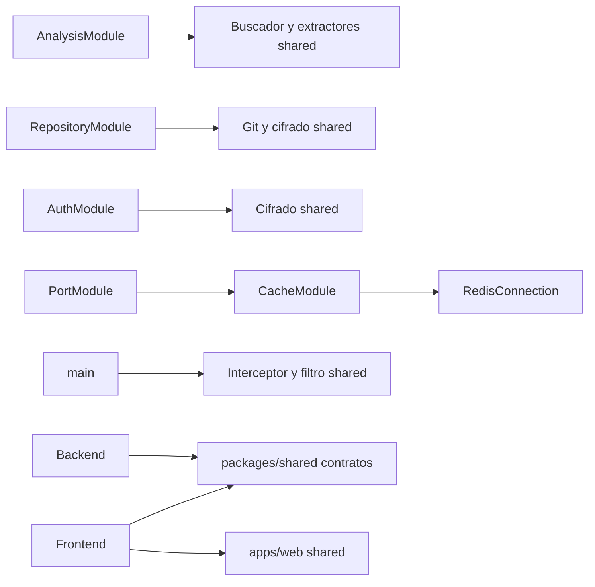

---
tags:
  - neoglito
  - shared
  - documentacion-tecnica
funcionalidad: Shared
actualizado: 2026-10-10
---

# Shared · arquitectura y consumidores

## Organización y registro

Estar en shared no registra automáticamente un servicio en Nest. Los módulos funcionales enlazan los tokens con sus implementaciones; los helpers de presentación se instalan en bootstrap o se aplican en controladores.

| Pieza | Registro actual | Consumidor efectivo |
|---|---|---|
| FILE_FINDER_PORT → RecursiveFileFinderService | AnalysisModule, useClass | ProjectAnalysisService |
| ENVIROMENT_VARIABLE_EXTRACT_PORT → YamlComposeEnviromentVariableExtractService | AnalysisModule, useClass | ProjectAnalysisService |
| COMPOSE_PORT_EXTRACT_PORT → YamlComposePortExtractService | AnalysisModule, useClass | ProjectAnalysisService |
| ENCRYPTION_PORT → Aes256GcmEncryptionService | AuthModule y RepositoryModule, useClass | OAuth, listado GitHub y clonación |
| GIT_CLONER_PORT → GitCloneRepositoryService | RepositoryModule, useClass | CloneRepositoryUseCase |
| CACHE_PORT → RedisCache | CacheModule, useExisting | API genérica disponible; no se encontró inyección actual del token en casos de uso |
| RedisConnection | CacheModule; exportado directamente | RedisPortReservationService |
| ApiResponseInterceptor y ApiExceptionFilter | main con useGlobalInterceptors/useGlobalFilters | Respuestas HTTP del backend |
| ApiSuccessResponseDoc | Decoradores de controladores | Esquema Swagger |

CacheModule exporta CACHE_PORT y RedisConnection. La reserva de puertos usa el cliente Redis directamente para scripts y claves propias; no pasa por RedisCache. AnalysisModule exporta ProjectAnalysisService, no todos sus proveedores internos. RepositoryModule exporta CloneRepositoryUseCase.

## Implementaciones presentes sin conexión al flujo activo

FindDockerFilesUseCase, FIND_FILES_PORT y FileSystemFindFilesService existen, pero en los registros/imports revisados no se encontró su instalación como proveedores para el análisis actual. ProjectAnalysisService utiliza FILE_FINDER_PORT y RecursiveFileFinderService con una regex más restringida.

normalizeText se exporta en packages/shared; no se encontraron llamadas en src ni en el frontend revisado. Su existencia no significa que todos los nombres o búsquedas se normalicen con ese helper.

## ORM y endpoints

Shared no define modelos Prisma ni un controlador HTTP. EncryptionPort recibe strings; Git recibe credenciales ya obtenidas; los extractores reciben rutas; Redis recibe claves. La lectura de GitHubConnection o escritura de Project/Deployment la hacen consumidores externos.

AuthenticatedRequest extiende Request de Express con user `{id, username}`. Es un contrato de tipos; no autentica ni valida la presencia de user. JwtAuthGuard y la estrategia del módulo Auth aportan el dato en las rutas protegidas.

## Alcance del paquete común

packages/shared contiene contratos transportables entre procesos; src/shared contiene dependencias del servidor como filesystem, crypto, Redis y Nest. apps/web/src/shared contiene dependencias del navegador y React. Importar implementaciones del servidor en el frontend mezclaría esas responsabilidades; el flujo actual reutiliza interfaces mediante `@neoglito/shared`.

Volver a [[Shared - Indice]].

## Fuentes del código

- [src/analisys/analysis.module.ts](file:///C:/Users/Uriel-Galvan/Documents/Proyectos%20Programacion/neoglito/src/analisys/analysis.module.ts)
- [src/auth/auth.module.ts](file:///C:/Users/Uriel-Galvan/Documents/Proyectos%20Programacion/neoglito/src/auth/auth.module.ts)
- [src/repository/repository.module.ts](file:///C:/Users/Uriel-Galvan/Documents/Proyectos%20Programacion/neoglito/src/repository/repository.module.ts)
- [src/ports/port.module.ts](file:///C:/Users/Uriel-Galvan/Documents/Proyectos%20Programacion/neoglito/src/ports/port.module.ts)
- [src/ports/infrastructure/reservations/redis-port-reservation.service.ts](file:///C:/Users/Uriel-Galvan/Documents/Proyectos%20Programacion/neoglito/src/ports/infrastructure/reservations/redis-port-reservation.service.ts)
- [src/shared/presentation/http/authenticated-request.ts](file:///C:/Users/Uriel-Galvan/Documents/Proyectos%20Programacion/neoglito/src/shared/presentation/http/authenticated-request.ts)
- [src/main.ts](file:///C:/Users/Uriel-Galvan/Documents/Proyectos%20Programacion/neoglito/src/main.ts)
- [packages/shared/src/index.ts](file:///C:/Users/Uriel-Galvan/Documents/Proyectos%20Programacion/neoglito/packages/shared/src/index.ts)
