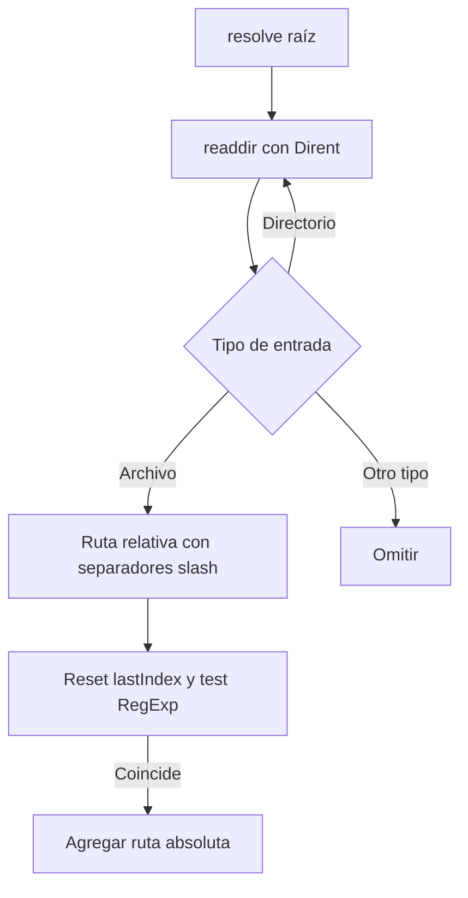

---
tags:
  - neoglito
  - shared
  - documentacion-tecnica
funcionalidad: Shared
actualizado: 2026-10-10
---

# Shared · búsqueda de archivos

## Buscador usado en análisis

RecursiveFileFinderService.findFile(directoryPath, pattern) resuelve la raíz a absoluta y recorre directorios con readdir y withFileTypes. Para cada archivo construye la ruta relativa a la raíz, cambia separadores nativos a `/`, reinicia pattern.lastIndex a 0 y prueba la regex. Retorna las rutas absolutas de los archivos que coinciden.

El recorrido es secuencial dentro de cada directorio y recursivo. No excluye .git, node_modules, dist ni carpetas ocultas. No ordena resultados explícitamente. Solo visita entradas isDirectory y acepta entradas isFile: las entradas symlink no se siguen por esa comprobación de Dirent.

ProjectAnalysisService pasa `/(^|\/)docker-compose.*\.yml$/`, sensible a mayúsculas. Admite docker-compose.yml y variantes .yml; no descubre compose.yml, compose.yaml, docker-compose.yaml ni Dockerfiles. El nombre genérico del servicio no limita esa capacidad: la restricción viene de la regex del consumidor.

## Buscador alternativo

FileSystemFindFilesService.findFiles(rootPath, patterns) convierte cada patrón en una regex anclada y case-insensitive. Escapa metacaracteres y transforma `*` en `.*`. Compara contra entry.name, no contra la ruta relativa completa.

Ignora directorios con nombres exactos .git, node_modules, .next, dist y build. Visita entradas mediante Promise.all y acumula coincidencias; al final las ordena con localeCompare. Usa join sobre la raíz recibida sin resolverla a absoluta, por lo que una raíz relativa produce rutas relativas al proceso. Tampoco sigue entradas symlink.

FindDockerFilesUseCase recibe este puerto y busca Dockerfile, Dockerfile.*, docker-compose.yml/.yaml, docker-compose.*.yml/.yaml y compose.yml/.yaml. Luego transforma cada ruta encontrada a relativa respecto a repositoryPath usando path.relative, con separadores del sistema operativo.

No se encontró registro activo de FIND_FILES_PORT/este caso de uso en el análisis actual. Sus patrones amplios y exclusiones no describen el comportamiento efectivo de ProjectAnalysisService.

## Comparación

| Propiedad | RecursiveFileFinderService | FileSystemFindFilesService |
|---|---|---|
| Entrada de filtro | RegExp | Array de patrones simples |
| Texto comparado | Ruta relativa con slash | Nombre del archivo |
| Mayúsculas | Según flags recibidos | Insensible |
| Carpetas ignoradas | Ninguna | Cinco nombres definidos |
| Ejecución del recorrido | Secuencial | Promise.all por nivel |
| Orden final | Sin sort propio | localeCompare |
| Ruta de retorno | Absoluta | Depende de rootPath recibido |
| Consumidor actual | ProjectAnalysisService | No encontrado en flujo activo |

Ambos propagan errores de readdir: no saltan automáticamente carpetas con permisos insuficientes ni retornan resultados parciales ante un fallo. No tienen límites de profundidad, cantidad de archivos o timeout propios.

Las pruebas del buscador activo crean archivos temporales y verifican coincidencia por ruta relativa y reinicio de regex con flag g. Se revisaron, no se ejecutaron.

Volver a [[Shared - Indice]].

## Fuentes del código

- [src/shared/infrastructure/files/recursive-file-finder.service.ts](file:///C:/Users/Uriel-Galvan/Documents/Proyectos%20Programacion/neoglito/src/shared/infrastructure/files/recursive-file-finder.service.ts)
- [src/shared/infrastructure/file-system/file-system-find-files.service.ts](file:///C:/Users/Uriel-Galvan/Documents/Proyectos%20Programacion/neoglito/src/shared/infrastructure/file-system/file-system-find-files.service.ts)
- [src/shared/application/find-docker-files.ts](file:///C:/Users/Uriel-Galvan/Documents/Proyectos%20Programacion/neoglito/src/shared/application/find-docker-files.ts)
- [src/analisys/application/project-analysis.service.ts](file:///C:/Users/Uriel-Galvan/Documents/Proyectos%20Programacion/neoglito/src/analisys/application/project-analysis.service.ts)
- [src/shared/infrastructure/files/recursive-file-finder.service.spec.ts](file:///C:/Users/Uriel-Galvan/Documents/Proyectos%20Programacion/neoglito/src/shared/infrastructure/files/recursive-file-finder.service.spec.ts)
