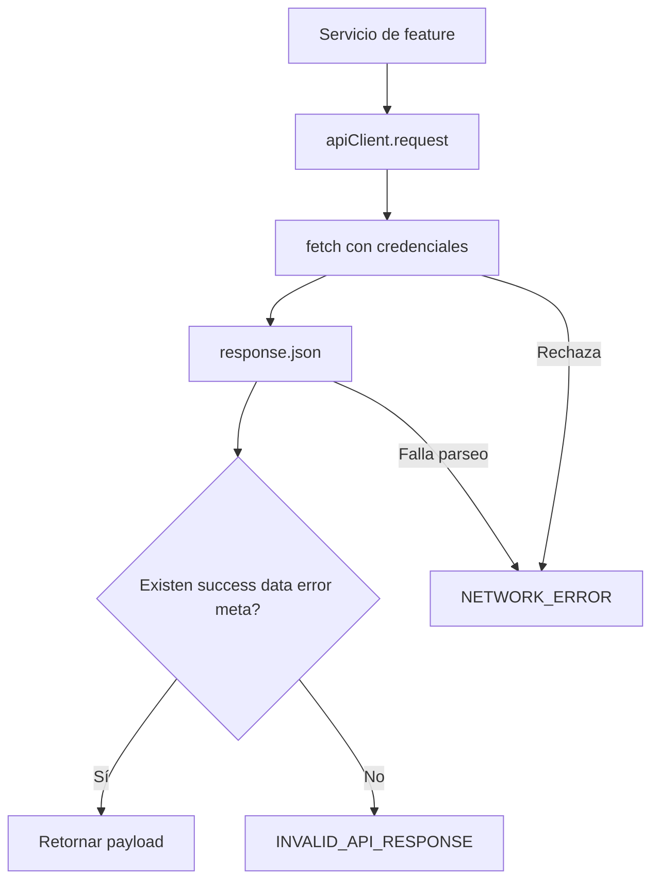

---
tags:
  - neoglito
  - shared
  - documentacion-tecnica
funcionalidad: Shared
actualizado: 2026-10-10
---

# Shared · cliente HTTP del frontend

## Configuración y transporte

apiClient usa `(VITE_API_URL ?? 'http://localhost:3000').replace(/\/$/, '')`: elimina un slash final. request(path, options) concatena base y path, llama fetch y luego response.json.

Siempre establece credentials include después de options, de modo que no se sobreescribe mediante el argumento. Añade Accept application/json y combina options.headers por propagación de objeto. No configura Bearer por sí mismo; el flujo normal utiliza la cookie de sesión.

| Método | Implementación |
|---|---|
| get(path) | request con opciones predeterminadas |
| post(path,body) | method POST, Content-Type application/json, JSON.stringify(body) |
| delete(path) | method DELETE |
| request(path,options) | Método general con RequestInit |

No hay helper put/patch, paginación, renovación de sesión, backoff, timeout propio ni tratamiento especial de 401. request admite RequestInit, que puede aportar signal, pero el cliente no crea uno automáticamente.

## Pipeline y errores



isApiResponse comprueba un objeto no nulo y presencia de las cuatro propiedades. No verifica tipos, coherencia entre success/data/error ni estructura de T. Un payload con campos mal tipados puede pasar esa comprobación.

No consulta response.ok ni response.status para tomar una decisión. Si un HTTP 400/500 trae la envoltura esperada, la devuelve tal cual para que el consumidor revise success. Un JSON sin envoltura genera INVALID_API_RESPONSE con el payload original en details.

El catch genera NETWORK_ERROR con mensaje de conexión y details del Error si existe. También captura JSON inválido, una respuesta vacía o un abort, de modo que ese code no demuestra que falló la conectividad. El estado HTTP original no se incluye automáticamente en ApiResponse.

## Uso correcto según consumidores actuales

Los servicios funcionales retornan Promise de ApiResponse. Los hooks suelen comprobar success y data; las queryFn lanzan Error para que React Query active isError. No todas las mutaciones genéricas convierten success false en rechazo: el caso concreto debe revisar la respuesta.

```ts
const response = await apiClient.get<ProjectResponse[]>('/project')
if (!response.success || !response.data) {
  throw new Error(response.error?.message ?? 'No fue posible cargar proyectos')
}
return response.data
```

El ejemplo ilustra el patrón actual; requiere importar los tipos y el cliente correspondientes. Los datos dentro de data siguen siendo JSON: la conversión a Date pertenece a los mappers de features.

contracts.ts reexporta contratos del paquete común para el frontend. No genera endpoints ni implementa schemas de validación. La autenticación cookie y CORS se desarrollan en [[Autenticacion - Uso y frontend]].

Volver a [[Shared - Indice]].

## Fuentes del código

- [apps/web/src/shared/api/client.ts](file:///C:/Users/Uriel-Galvan/Documents/Proyectos%20Programacion/neoglito/apps/web/src/shared/api/client.ts)
- [apps/web/src/shared/api/contracts.ts](file:///C:/Users/Uriel-Galvan/Documents/Proyectos%20Programacion/neoglito/apps/web/src/shared/api/contracts.ts)
- [apps/web/src/features/projects/hooks/use-projects.ts](file:///C:/Users/Uriel-Galvan/Documents/Proyectos%20Programacion/neoglito/apps/web/src/features/projects/hooks/use-projects.ts)
- [apps/web/src/features/repositories/use-repositories.ts](file:///C:/Users/Uriel-Galvan/Documents/Proyectos%20Programacion/neoglito/apps/web/src/features/repositories/use-repositories.ts)
- [src/main.ts](file:///C:/Users/Uriel-Galvan/Documents/Proyectos%20Programacion/neoglito/src/main.ts)
