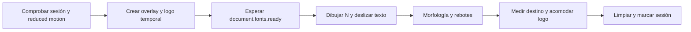

---
tags:
  - neoglito
  - shared
  - documentacion-tecnica
funcionalidad: Shared
actualizado: 2026-10-10
---

# Shared · estado, utilidades y branding

## Contextos de reducer

createReducerContext<State,Action>(name,reducer,initialState) crea dos contextos: uno para estado y otro para dispatch. Usa un Symbol MISSING por fábrica para distinguir ausencia de Provider de un estado legítimamente null.

Provider ejecuta useReducer y publica ambos valores en contextos anidados. useState y useDispatch comparan el valor con MISSING; si falta Provider lanzan un Error con el nombre del contexto. No persiste datos en disco ni localStorage y no reemplaza React Query.

ProjectsProvider, RepositoriesProvider, DeploysProvider y AnalysisProvider consumen la fábrica. Separar dispatch permite leer esa referencia sin leer el estado; no hay selectores de estado por campo dentro de esta utilidad. Cada Provider tiene su propio estado; montar uno nuevo inicia desde initialState.

## Tema

useTheme lee localStorage con clave neoglito-theme. Solo el string dark inicia oscuro; los demás valores inician light. Un efecto escribe el tema actual y toggleTheme alterna light/dark. Retorna theme, isDark y toggleTheme.

No sigue prefers-color-scheme ni eventos storage entre pestañas. Los accesos localStorage no tienen try/catch y dependen del navegador. El hook no cambia clases del DOM por sí mismo: AppLayout aplica data-theme dark/light en su contenedor.

## Fechas

formatDate usa Intl.DateTimeFormat es-MX con día numérico, mes corto y año. formatRelativeTime calcula minutos con Math.round de Date.now menos date:

| Resultado calculado | Texto |
|---|---|
| Menos de 1 minuto | ahora |
| Menos de 60 minutos | hace N min |
| Horas redondeadas menores a 24 | hace N h |
| Días redondeados | hace 1 día o hace N días |

No programa un timer para refrescar etiquetas. Al redondear, la frontera de categorías puede adelantarse respecto al tiempo exacto. Fechas futuras producen minutos negativos y pasan por ahora. No valida Date inválido ni maneja zonas horarias explícitamente en estas funciones.

## Iconos y logo

AppIcon envuelve MorphIcon de morphicons/react con valores predeterminados size 18, strokeWidth 2, absoluteStrokeWidth true y reducedMotion user. Permite propiedades adicionales y sobrescribir esos argumentos mediante props declaradas.

NeoglitoLogo renderiza el estado final con SVG y texto, role img y aria-label Neoglito. Usa currentColor para el trazo y colores de acento según tema. Recibe ref, className y style; AppLayout usa el ref como destino del splash.

## Pipeline del splash

shouldPlayNeoglitoSplash retorna false si matchMedia indica reduced motion o sessionStorage contiene neoglito-splash-played = 1. Si falla sessionStorage retorna true. Depende de window; no define un fallback de ejecución SSR.

useNeoglitoSplash inicia docked como el inverso de esa comprobación. Conserva isDark inicial en un ref; el efecto no actualiza ese ref al cambiar el tema. Si falta target o ya está docked, no ejecuta animación. En caso contrario llama playNeoglitoSplash y al desmontar llama cancel.

playNeoglitoSplash inyecta CSS una vez por id ngs-style, agrega overlay y wrapper al body y bloquea overflow del elemento raíz guardando su valor previo. Usa requestAnimationFrame, interpolaciones y easing para dibujar el SVG, desplazar el texto y rebotar el nodo.

Opciones: target, background, ink, accent, bounces opcional (default 3 y mínimo 1), zIndex opcional (default 9999) y onDock opcional. DOCK_AT se calcula con BOUNCE_AT 2950 ms, periodo 1400 ms y parte final de rebote; el acomodo dura 900 ms. Los tiempos son de animación después de fonts.ready, no de carga del backend.

Durante el acomodo vuelve a medir target cada frame para seguir cambios de tamaño. cleanup cancela el frame, elimina overlay/wrapper y restaura overflow; no elimina el CSS inyectado. finish limpia, marca sessionStorage e invoca onDock. cancel solo limpia: no marca sesión ni llama onDock.

AppLayout mantiene invisible el logo definitivo mientras docked es false. Esta secuencia es visual y no espera que Redis, Docker, autenticación o queries estén listos. La preferencia de movimiento se evalúa al decidir reproducir; playNeoglitoSplash no la revalida por sí mismo en cada frame.

Volver a [[Shared - Indice]].

## Fuentes del código

- [apps/web/src/shared/state/create-reducer-context.tsx](file:///C:/Users/Uriel-Galvan/Documents/Proyectos%20Programacion/neoglito/apps/web/src/shared/state/create-reducer-context.tsx)
- [apps/web/src/shared/hooks/use-theme.ts](file:///C:/Users/Uriel-Galvan/Documents/Proyectos%20Programacion/neoglito/apps/web/src/shared/hooks/use-theme.ts)
- [apps/web/src/shared/utils/relative-time.ts](file:///C:/Users/Uriel-Galvan/Documents/Proyectos%20Programacion/neoglito/apps/web/src/shared/utils/relative-time.ts)
- [apps/web/src/shared/components/app-icon.tsx](file:///C:/Users/Uriel-Galvan/Documents/Proyectos%20Programacion/neoglito/apps/web/src/shared/components/app-icon.tsx)
- [apps/web/src/shared/branding/neoglito-logo.tsx](file:///C:/Users/Uriel-Galvan/Documents/Proyectos%20Programacion/neoglito/apps/web/src/shared/branding/neoglito-logo.tsx)
- [apps/web/src/shared/branding/neoglito-splash.ts](file:///C:/Users/Uriel-Galvan/Documents/Proyectos%20Programacion/neoglito/apps/web/src/shared/branding/neoglito-splash.ts)
- [apps/web/src/shared/branding/use-neoglito-splash.ts](file:///C:/Users/Uriel-Galvan/Documents/Proyectos%20Programacion/neoglito/apps/web/src/shared/branding/use-neoglito-splash.ts)
- [apps/web/src/app/app-layout.tsx](file:///C:/Users/Uriel-Galvan/Documents/Proyectos%20Programacion/neoglito/apps/web/src/app/app-layout.tsx)
- [apps/web/src/pages/repository-selection-page.tsx](file:///C:/Users/Uriel-Galvan/Documents/Proyectos%20Programacion/neoglito/apps/web/src/pages/repository-selection-page.tsx)
