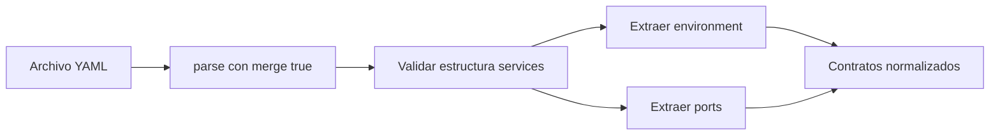

---
tags:
  - neoglito
  - shared
  - documentacion-tecnica
funcionalidad: Shared
actualizado: 2026-10-10
---

# Shared · extracción Compose

## Pipeline común

Ambos extractores reciben filePath, leen UTF-8 y llaman parse de yaml con merge true. El análisis requiere un documento objeto con services objeto. Si esa estructura no existe, retorna arrays vacíos. Errores de lectura o YAML inválido se propagan; no se traducen a una excepción HTTP propia aquí.

ProjectAnalysisService coordina las dos lecturas por archivo mediante Promise.all; cada extractor lee y parsea independientemente. Con includePorts false no llama al extractor de puertos. No hay caché de YAML ni escritura del documento por estas clases.

## Variables: mapa y lista

El extractor recorre solo services.<nombre>.environment. En mapa serializa string, number y boolean con String; null/undefined u objetos/arrays se convierten a null y luego a una interpolación con el nombre de la entrada.

En lista ignora entradas no string. Divide una cadena en el primer `=`: el resto completo es el valor. Una entrada sin `=` representa interpolación del mismo nombre. No recorta nombres ni valores ni valida un regex de nombres environment.

| Entrada ilustrativa | source | value | defaultValue |
|---|---|---|---|
| MODE: production | literal | production | null |
| ENABLED: true | literal | true, como string | null |
| EMPTY: null | interpolation | EMPTY | null |
| PORT: ${APP_PORT:-3000} | interpolation | APP_PORT | 3000 |
| SECRET: ${TOKEN?mensaje} | interpolation | TOKEN | null |
| Lista OPTIONAL_SECRET sin = | interpolation | OPTIONAL_SECRET | null |
| Lista TOKEN=a=b | literal | a=b | null |

La salida conserva service y name de la entrada, que pueden diferir de value. Los valores de ejemplo son resultados de reglas del código, no expansión real del entorno.

## Interpolación detectada

Busca la primera expresión con llaves `${VARIABLE}`, con operadores opcionales `:-`, `-`, `:?` o `?`. Solo `:-` y `-` producen defaultValue. No conserva una distinción entre vacío y ausente ni ejecuta los errores que Compose asociaría a los operadores de requisito.

La regex con llaves no está anclada al valor completo. En `postgres://${DB_USER}:${DB_PASSWORD}@db`, captura primero DB_USER y pierde en la salida la estructura del string y las demás referencias. La variante `$VARIABLE` sin llaves solo se detecta cuando ocupa toda la cadena. No implementa expresiones anidadas, todas las reglas de escape ni sustitución de `.env` o process.env.

No analiza env_file, variables de build args, command, labels ni otros campos Compose. Los objetos environment inválidos pueden convertirse en una interpolación en vez de generar un error explícito de esquema.

## Puertos: extracción y normalización

YamlComposePortExtractService recorre services y sus ports solo si son arrays. Para cada entrada llama parseComposePort; descarta las que devuelven null.

En string/number separa por `/` para protocolo (default tcp), por `:` para target al final, published penúltimo y hostIp como unión de segmentos anteriores. En sintaxis larga exige target string/number y published ausente/null/string/number, toma host_ip solo si es string y protocol string o tcp.

| Entrada | hostIp | publishedPort | targetPort | protocol |
|---|---|---|---|---|
| 3000 | null | null | 3000 | tcp |
| 8080:80 | null | 8080 | 80 | tcp |
| 127.0.0.1:8080:80/udp | 127.0.0.1 | 8080 | 80 | udp |
| 8000-8002:80-82 | null | 8000-8002 | 80-82 | tcp |
| ${PORT}:3000 | null | ${PORT} | 3000 | tcp |

Todas esas cifras se devuelven como strings. mappingType es range si published o target coincide con dígitos-guion-dígitos; en otros casos one-to-one. No expande rangos ni verifica orden, correspondencia de longitudes, rango 1–65535 o protocolos permitidos. Un texto target no vacío puede normalizarse aunque Docker no lo acepte.

No realiza una comprobación integral de sintaxis IPv6. Las expresiones permanecen sin resolver. No extrae expose ni comprueba disponibilidad de puertos. Opciones largas como mode/name no están en el resultado normalizado; Deployment conserva/modifica el YAML mediante su propio preparador.

parseComposePort también se usa en la preparación de Deployment, pero la validación posterior de edición, reservas y modo espejo es independiente. Consultar [[Analisis - Variables y puertos]], [[Deployment - Preparacion Compose]] y [[Ports - Indice]].

Volver a [[Shared - Indice]].

## Fuentes del código

- [src/shared/infrastructure/compose/yaml-compose-enviroment-variable-extract.service.ts](file:///C:/Users/Uriel-Galvan/Documents/Proyectos%20Programacion/neoglito/src/shared/infrastructure/compose/yaml-compose-enviroment-variable-extract.service.ts)
- [src/shared/infrastructure/compose/yaml-compose-port-extract.service.ts](file:///C:/Users/Uriel-Galvan/Documents/Proyectos%20Programacion/neoglito/src/shared/infrastructure/compose/yaml-compose-port-extract.service.ts)
- [src/shared/application/compose-ports.ts](file:///C:/Users/Uriel-Galvan/Documents/Proyectos%20Programacion/neoglito/src/shared/application/compose-ports.ts)
- [src/analisys/application/project-analysis.service.ts](file:///C:/Users/Uriel-Galvan/Documents/Proyectos%20Programacion/neoglito/src/analisys/application/project-analysis.service.ts)
- [src/deployment/infrastructure/compose/yaml-deployment-compose.service.ts](file:///C:/Users/Uriel-Galvan/Documents/Proyectos%20Programacion/neoglito/src/deployment/infrastructure/compose/yaml-deployment-compose.service.ts)
