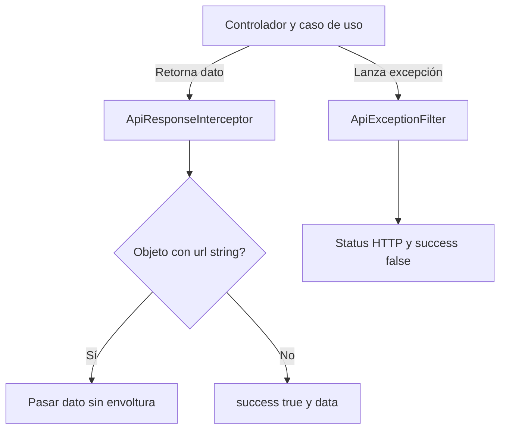

---
tags:
  - neoglito
  - shared
  - documentacion-tecnica
funcionalidad: Shared
actualizado: 2026-10-10
---

# Shared · HTTP, errores y Swagger

## Flujo de respuesta

main registra ApiExceptionFilter y ApiResponseInterceptor globalmente antes de listen. Las interfaces del paquete definen la forma común; las clases Nest producen esa forma durante la ejecución.



## Éxitos

El interceptor aplica map a next.handle y retorna `{success:true,data,error:null,meta:null}`. No añade paginación ni decide el código HTTP; este depende del controlador/Nest. No comprueba si el valor ya tenía una envoltura ApiResponse: un controlador que devolviera ese objeto también sería envuelto.

La excepción usa una comprobación estructural: cualquier objeto no nulo con propiedad url de tipo string pasa intacto. Esto permite el contrato de redirección OAuth, pero la condición no comprueba @Redirect ni statusCode. Un dato de negocio con campo url string también satisface esa regla.

## Errores

ApiExceptionFilter usa @Catch sin tipo, obtiene Response de Express y decide status: getStatus de HttpException o 500 para otros errores. Construye `{success:false,data:null,error,meta:null}` y ejecuta response.status(status).json(body).

| Forma de excepción | code | message/details |
|---|---|---|
| HttpException con respuesta string | Nombre del HttpStatus | La respuesta string |
| HttpException con respuesta objeto | response.error si string; en otro caso nombre del HttpStatus | message string, o array unido por coma; array también en details |
| Objeto HTTP sin message utilizable | Según regla anterior | Ocurrió un error inesperado |
| Error ordinario | INTERNAL_SERVER_ERROR | exception.message |
| Valor no Error/no HttpException | INTERNAL_SERVER_ERROR | Ocurrió un error inesperado |

code no es siempre un identificador fijo en mayúsculas: puede ser el texto error de Nest, por ejemplo Bad Request. El filtro no traduce errores Prisma a 409 ni errores filesystem a 404. No añade stack a la respuesta, pero puede exponer el mensaje de Error o del adaptador Git. No registra logging adicional en este archivo.

Ejemplo ilustrativo:

```json
{"success":false,"data":null,"error":{"code":"Bad Request","message":"Dato inválido"},"meta":null}
```

## Request autenticado

AuthenticatedRequest extiende Request de Express con user id/username. El tipo permite acceder al dato en controladores; no instala un guard ni convierte una ruta pública en protegida. Esa autorización pertenece a Auth y a los decoradores del controlador.

## Swagger

api-response.schemas.ts contiene clases con ApiProperty para ApiError, ApiMeta, envoltura de éxito, usuario, Project, Repository, variables, puertos y Deployment. Incluye ejemplos, nullabilidad y algunos enums. Estas clases describen OpenAPI; no son modelos Prisma ni validadores runtime.

ApiSuccessResponseDoc recibe status, description, dataSchema y extraModels opcional. Usa applyDecorators con ApiExtraModels y ApiResponse. El schema compone con allOf una referencia a la envoltura común y un objeto cuyo campo data tiene el schema proporcionado. El controlador debe pasar referencias/modelos adecuados.

No modifica el status real, la serialización, la autenticación o el dato retornado. Los POST de actualización Project e init documentados como 200 conservan 201 si no llevan HttpCode. Los tipos compartidos de Deployment usan strings mientras Swagger enumera valores; esa diferencia debe mantenerse consciente al cambiar contratos.

Swagger se monta en /docs desde main. No hay endpoint propio del área Shared. Las rutas y parámetros reales se documentan en las notas de cada funcionalidad.

Volver a [[Shared - Indice]].

## Fuentes del código

- [src/main.ts](file:///C:/Users/Uriel-Galvan/Documents/Proyectos%20Programacion/neoglito/src/main.ts)
- [src/shared/presentation/interceptors/api-response.interceptor.ts](file:///C:/Users/Uriel-Galvan/Documents/Proyectos%20Programacion/neoglito/src/shared/presentation/interceptors/api-response.interceptor.ts)
- [src/shared/presentation/filters/api-exception.filter.ts](file:///C:/Users/Uriel-Galvan/Documents/Proyectos%20Programacion/neoglito/src/shared/presentation/filters/api-exception.filter.ts)
- [src/shared/presentation/http/authenticated-request.ts](file:///C:/Users/Uriel-Galvan/Documents/Proyectos%20Programacion/neoglito/src/shared/presentation/http/authenticated-request.ts)
- [src/shared/presentation/swagger/api-response.schemas.ts](file:///C:/Users/Uriel-Galvan/Documents/Proyectos%20Programacion/neoglito/src/shared/presentation/swagger/api-response.schemas.ts)
- [src/project/presentation/project.controller.ts](file:///C:/Users/Uriel-Galvan/Documents/Proyectos%20Programacion/neoglito/src/project/presentation/project.controller.ts)
- [src/deployment/presentation/deployment.controller.ts](file:///C:/Users/Uriel-Galvan/Documents/Proyectos%20Programacion/neoglito/src/deployment/presentation/deployment.controller.ts)
