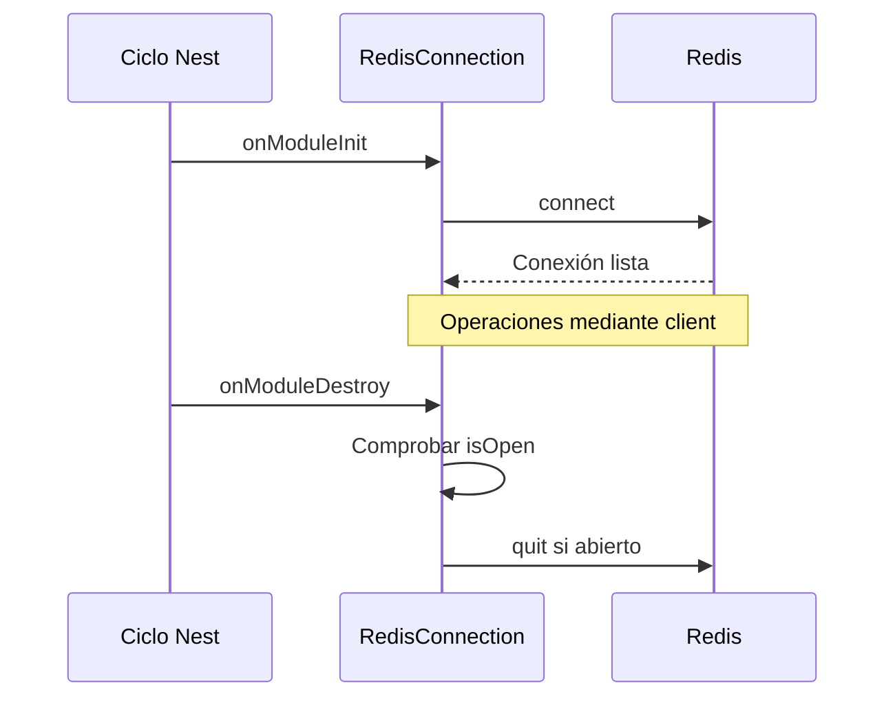

---
tags:
  - neoglito
  - shared
  - documentacion-tecnica
funcionalidad: Shared
actualizado: 2026-10-10
---

# Shared · Redis y caché

## Registro y ciclo de vida

CacheModule registra RedisConnection y RedisCache como proveedores concretos. CACHE_PORT usa useExisting RedisCache, por lo que ambos identificadores acceden a la misma instancia de caché en ese registro. Exporta CACHE_PORT y RedisConnection.

RedisConnection crea su cliente con REDIS_URL o redis://localhost:6379. Instala un listener error que escribe al logger. onModuleInit espera client.connect; onModuleDestroy llama quit si isOpen es true. No hay catch que convierta una conexión fallida en caché opcional ni configuración propia de fallback.

El hook de destrucción define cómo cerrar el recurso cuando Nest destruye el módulo. Main no habilita explícitamente enableShutdownHooks; no debe asumir que todo tipo de señal o terminación abrupta ejecuta ese cierre.

## Operaciones de RedisCache

| Método | Redis | Observaciones |
|---|---|---|
| get(key) | GET | string o null |
| set(key,value) | SET sin opciones | No conserva explícitamente un TTL anterior |
| set(key,value,ttl) | SET con EX | ttl entero positivo en segundos |
| delete(key) | DEL | Retorna void, no cantidad eliminada |
| exists(key) | EXISTS | true solo si respuesta es 1 |
| getAll() | SCAN COUNT 100 y MGET por lote | Mapa de claves a strings no nulos |

TTL undefined elige SET simple. Cero, negativos, fracciones y otros valores no enteros provocan RangeError “Redis cache TTL must be a positive number of seconds”. No se redondea el TTL. No hay serialización JSON automática: el contrato trabaja con strings.

## getAll y alcance de claves

scanIterator no tiene MATCH ni namespace. Visita las claves del database seleccionado por la conexión y hace mGet del lote. Ignora valores null/undefined, acumula pares y retorna Object.fromEntries. No devuelve una instantánea transaccional; claves pueden cambiar o expirar durante el recorrido. Si una clave se repite durante scan, el objeto final conserva la última asignación acumulada.

COUNT 100 es un parámetro de recorrido, no paginación de API ni límite del total. El resultado y los pares se mantienen en memoria; no existe límite global. Claves con datos no compatibles con GET/MGET no se transforman a objetos de caché de otros tipos.

## Relación con reservas

RedisPortReservationService inyecta RedisConnection y usa raw client, eval y su propio MATCH para owner keys. RedisCache.getAll no es el algoritmo usado por GET /port. Reservas añaden invariantes y scripts que este CachePort genérico no implementa.

No se encontró un consumidor actual que inyecte CACHE_PORT en casos de uso. El proveedor está disponible, pero no debe atribuirle la caché de React Query ni la lógica de reservas. [[Ports - Redis y ORM]] explica las claves y consistencia, y [[Startup - ORM y Redis]] la restauración al arrancar.

Volver a [[Shared - Indice]].

## Fuentes del código

- [src/shared/infrastructure/cache/cache.module.ts](file:///C:/Users/Uriel-Galvan/Documents/Proyectos%20Programacion/neoglito/src/shared/infrastructure/cache/cache.module.ts)
- [src/shared/infrastructure/cache/redis-connection.service.ts](file:///C:/Users/Uriel-Galvan/Documents/Proyectos%20Programacion/neoglito/src/shared/infrastructure/cache/redis-connection.service.ts)
- [src/shared/infrastructure/cache/redis-cache.service.ts](file:///C:/Users/Uriel-Galvan/Documents/Proyectos%20Programacion/neoglito/src/shared/infrastructure/cache/redis-cache.service.ts)
- [src/shared/application/cache.port.ts](file:///C:/Users/Uriel-Galvan/Documents/Proyectos%20Programacion/neoglito/src/shared/application/cache.port.ts)
- [src/ports/infrastructure/reservations/redis-port-reservation.service.ts](file:///C:/Users/Uriel-Galvan/Documents/Proyectos%20Programacion/neoglito/src/ports/infrastructure/reservations/redis-port-reservation.service.ts)
- [src/main.ts](file:///C:/Users/Uriel-Galvan/Documents/Proyectos%20Programacion/neoglito/src/main.ts)
