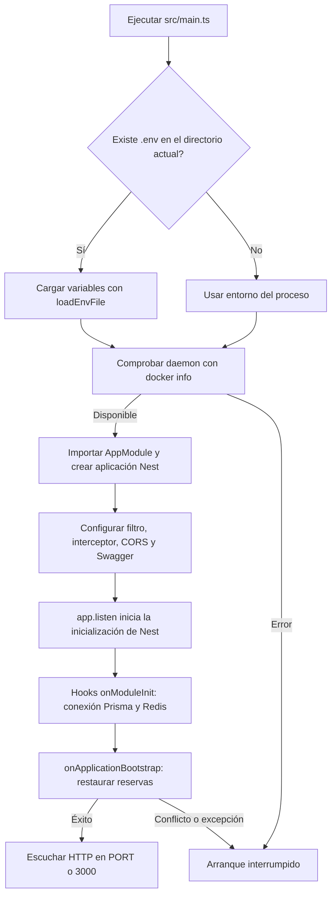
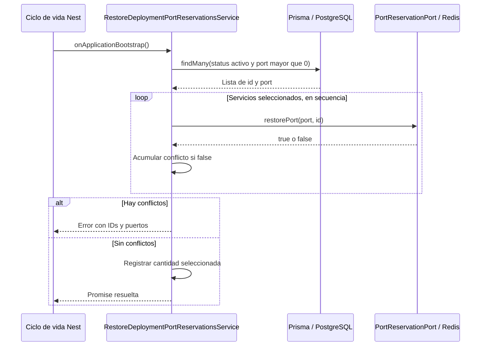

---
tags:
  - neoglito
  - startup
  - documentacion-tecnica
funcionalidad: startup
actualizado: 2026-10-10
---

# Startup · flujo

## Orden del arranque

`AppModule` se importa dinámicamente después de cargar `.env` y comprobar Docker. Esto permite que los módulos importados lean las variables durante su evaluación. No hay `ConfigModule` en este flujo.

La conexión Prisma y la conexión Redis ocurren en sus respectivos `onModuleInit`. El código no establece un orden relativo entre ambas; la recuperación sucede después de los hooks de inicialización. Se verificó en la implementación local de Nest que `listen()` llama a `init()` cuando hace falta, y que `init()` espera `callInitHook()` y después `callBootstrapHook()` antes de escuchar HTTP.

## Recuperación de reservas

Un `false` no corta el bucle: se intentan los demás servicios y al final se lanza un error con todos los conflictos encontrados. Una excepción de Prisma o Redis sí interrumpe inmediatamente la ejecución. No existe rollback de reservas ya restauradas.

Si la consulta no devuelve servicios, el arranque continúa y el log indica cero. El mensaje de éxito cuenta filas seleccionadas, incluidas reservas que ya estaban correctas; no mide nuevas claves creadas.

Consulta las reglas exactas en [[Startup - ORM y Redis]] y los errores en [[Startup - Uso configuracion y diagnostico]].

## Fuentes del código

- [src/main.ts](file:///C:/Users/Uriel-Galvan/Documents/Proyectos%20Programacion/neoglito/src/main.ts)
- [src/prisma/prisma.service.ts](file:///C:/Users/Uriel-Galvan/Documents/Proyectos%20Programacion/neoglito/src/prisma/prisma.service.ts)
- [src/shared/infrastructure/cache/redis-connection.service.ts](file:///C:/Users/Uriel-Galvan/Documents/Proyectos%20Programacion/neoglito/src/shared/infrastructure/cache/redis-connection.service.ts)
- [src/startup/restore-deployment-port-reservations.service.ts](file:///C:/Users/Uriel-Galvan/Documents/Proyectos%20Programacion/neoglito/src/startup/restore-deployment-port-reservations.service.ts)
- [node_modules/@nestjs/core/nest-application.js](file:///C:/Users/Uriel-Galvan/Documents/Proyectos%20Programacion/neoglito/node_modules/%40nestjs/core/nest-application.js)
