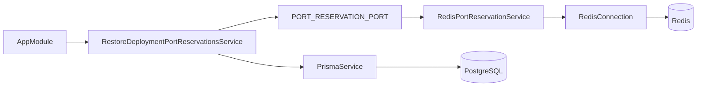

---
tags:
  - neoglito
  - startup
  - documentacion-tecnica
funcionalidad: startup
actualizado: 2026-10-10
---

# Startup · implementación y contratos

## Registro y dependencias

No existe un `StartupModule`: `AppModule` registra directamente `RestoreDeploymentPortReservationsService` en `providers` e importa `PrismaModule` y `PortModule`.

`PortModule` vincula el símbolo `PORT_RESERVATION_PORT` mediante `useExisting: RedisPortReservationService` y lo exporta. El servicio startup depende de la interfaz `PortReservationPort` e inyecta el símbolo en tiempo de ejecución. `CacheModule` proporciona y exporta `RedisConnection` para el adaptador.

## Contratos utilizados

| Función | Parámetros | Retorno | Responsabilidad |
| --- | --- | --- | --- |
| `bootstrap()` | Ninguno | `Promise<void>` | Configurar e iniciar backend; función interna de main |
| `assertDockerIsRunning()` | Ninguno | `void` o excepción | Comprobar CLI y daemon Docker |
| `onApplicationBootstrap()` | Ninguno | `Promise<void>` | Leer servicios y restaurar sus reservas |
| `restorePort(port, ownerId)` | `port: number`, `ownerId: string` | `Promise<boolean>` | Recuperar la asociación en Redis |

En startup, `ownerId` siempre es `DeploymentService.id`. No se usa `projectId`, `deploymentId` ni el identificador de una reserva temporal. `restorePort` no recibe TTL ni credenciales del usuario.

## Comprobación de Docker

Se prueban estos candidatos en orden: `DOCKER_PATH` si tiene valor, `docker`, `docker.exe` y `C:\Program Files\Docker\Docker\resources\bin\docker.exe`. Los candidatos distintos de los nombres simples se omiten si no existen como ruta.

Cada intento usa `spawnSync` con argumentos `['info', '--format', '{{.ServerVersion}}']`, salida UTF-8 y timeout de 10 segundos. Código de salida cero permite continuar. `ENOENT` prueba el siguiente candidato; otro error de ejecución lanza excepción. Un comando existente que sale con código distinto de cero detiene la búsqueda y produce el diagnóstico de daemon no disponible.

La comprobación es síncrona y ocurre antes de crear Nest. El timeout es por intento, no una garantía de duración total del arranque. No inicia Docker Desktop, no valida Compose y no comprueba los contenedores registrados en PostgreSQL.

## Configuración HTTP global

`main.ts` registra `ApiExceptionFilter`, `ApiResponseInterceptor`, CORS con `credentials: true` y origen `FRONTEND_URL` o `http://localhost:5174`. Swagger se monta en `/docs`, título `Neoglito API`, versión `1.0`, con definición Bearer.

Los errores anteriores a la escucha HTTP son errores de arranque; el filtro HTTP no los convierte en respuestas JSON para un cliente. El punto de entrada usa `await bootstrap()` sin recuperación personalizada.

El cierre de Redis está implementado en `onModuleDestroy` con `quit()` si el cliente está abierto. `main.ts` no llama a `enableShutdownHooks()`, por lo que no debe asumirse a partir de este código que ese hook se ejecutará ante cualquier señal del sistema.

Para la consulta y efectos sobre los datos, continúa en [[Startup - ORM y Redis]].

## Fuentes del código

- [src/app.module.ts](file:///C:/Users/Uriel-Galvan/Documents/Proyectos%20Programacion/neoglito/src/app.module.ts)
- [src/startup/restore-deployment-port-reservations.service.ts](file:///C:/Users/Uriel-Galvan/Documents/Proyectos%20Programacion/neoglito/src/startup/restore-deployment-port-reservations.service.ts)
- [src/ports/port.module.ts](file:///C:/Users/Uriel-Galvan/Documents/Proyectos%20Programacion/neoglito/src/ports/port.module.ts)
- [src/ports/application/port-reservation.port.ts](file:///C:/Users/Uriel-Galvan/Documents/Proyectos%20Programacion/neoglito/src/ports/application/port-reservation.port.ts)
- [src/shared/infrastructure/cache/cache.module.ts](file:///C:/Users/Uriel-Galvan/Documents/Proyectos%20Programacion/neoglito/src/shared/infrastructure/cache/cache.module.ts)
- [src/container/infrastructure/docker/assert-docker-is-running.ts](file:///C:/Users/Uriel-Galvan/Documents/Proyectos%20Programacion/neoglito/src/container/infrastructure/docker/assert-docker-is-running.ts)
- [src/main.ts](file:///C:/Users/Uriel-Galvan/Documents/Proyectos%20Programacion/neoglito/src/main.ts)
- [src/shared/infrastructure/cache/redis-connection.service.ts](file:///C:/Users/Uriel-Galvan/Documents/Proyectos%20Programacion/neoglito/src/shared/infrastructure/cache/redis-connection.service.ts)
