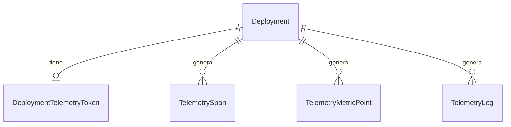

---
tags:
  - neoglito
  - telemetry
  - opentelemetry
  - documentacion-tecnica
funcionalidad: telemetry
actualizado: 2026-10-11
---

# Telemetry · API, ORM y retención

## Instrumentación de la propia API

`startTelemetrySdk()` arranca el SDK de Node (`@opentelemetry/sdk-node`) y se llama desde `main.ts` **antes** del `import()` dinámico de `AppModule`, después de cargar `.env`. Así las instrumentaciones parchean las librerías antes de que se importen.

| Elemento | Detalle |
| --- | --- |
| Condición | Solo arranca si `TELEMETRY_ENABLED` no es `false` y existen `OTEL_EXPORTER_OTLP_ENDPOINT` y `TELEMETRY_SYSTEM_TOKEN` |
| Recurso | `service.name` = `OTEL_SERVICE_NAME` o `neoglito-api` |
| Exporters | OTLP/HTTP a `<endpoint>/v1/{traces,metrics,logs}` con `authorization: Bearer <token de sistema>` |
| Métricas | Exportación periódica cada 30 s |
| Instrumentaciones | `http`, `express`, `nestjs-core`, `pg`, `redis` |
| ESM | Registra `@opentelemetry/instrumentation/hook.mjs` porque el proyecto es ESM |
| Cierre | En `SIGTERM`/`SIGINT` vacía los lotes pendientes y reemite la señal |

`TelemetryLogger` extiende `ConsoleLogger` y además emite cada línea de log como `LogRecord` de OpenTelemetry. `main.ts` crea la app con `bufferLogs: true` y llama a `app.useLogger(new TelemetryLogger())`.

## Modelo de datos

Definido en `prisma/models/telemetry.prisma`; la migración es `prisma/migrations/20261011120000_add_telemetry/migration.sql`.



| Modelo | Campos principales | Índices |
| --- | --- | --- |
| `DeploymentTelemetryToken` | `deploymentId` único, `tokenHash` único, `createdAt`, `revokedAt` | Los dos únicos |
| `TelemetrySpan` | `traceId`, `spanId`, `parentSpanId`, `name`, `kind`, `startTime`, `endTime`, `durationMs`, `statusCode`, `statusMessage`, `attributes`, `resource` | `(deploymentId, startTime)`, `traceId`, `startTime` |
| `TelemetryMetricPoint` | `name`, `unit`, `type`, `time`, `value` (Float, opcional), `histogram` (Json, opcional), `attributes` | `(deploymentId, name, time)`, `time` |
| `TelemetryLog` | `time`, `severity`, `body`, `traceId`, `spanId`, `attributes` | `(deploymentId, time)`, `time` |

`deploymentId` es opcional en las tres tablas de datos: nulo equivale a telemetría de la propia API. La relación con `Deployment` usa `onDelete: Cascade`, así que borrar un despliegue elimina su telemetría. Los repositorios guardan con `createMany` en lotes de 1000.

## Consulta para el frontend

`TelemetryQueryController` está bajo `@Controller('deployment/:deploymentId/telemetry')`, con `JwtAuthGuard` y documentado en Swagger (`Telemetry`). No es el receptor: cada controller tiene reglas distintas.

| | Receptor (`TelemetryIngestController`) | Consulta (`TelemetryQueryController`) |
| --- | --- | --- |
| Llama | Collector | Frontend |
| Auth | Token Bearer de telemetría | JWT de usuario |
| Respuesta | `{}` fuera del envelope | Envelope `ApiResponse` |
| Swagger | Excluido | Documentado |

| Ruta | Filtros específicos |
| --- | --- |
| `GET /deployment/:id/telemetry/traces` | — |
| `GET /deployment/:id/telemetry/metrics` | `name` |
| `GET /deployment/:id/telemetry/logs` | `severity` (se normaliza a mayúsculas) |

Filtros comunes: `service`, `from`, `to` (fechas ISO), `before` (cursor) y `limit`. Un valor de fecha inválido responde 400. El límite por defecto es 100 y el máximo 500.

```json
{
  "success": true,
  "data": {
    "items": [],
    "nextBefore": "2026-10-11T15:04:05.000Z"
  },
  "error": null,
  "meta": null
}
```

La paginación es por cursor de tiempo: el caso de uso pide `limit + 1` filas, devuelve `limit` y, si hubo una más, `nextBefore` es el instante del último elemento devuelto. Se envía como `before` en la siguiente petición. Si el despliegue no existe responde 404.

## Retención

`TelemetryRetentionService` ejecuta `PurgeExpiredTelemetryUseCase` al iniciar y cada hora (`setInterval` con `unref`, sin `@nestjs/schedule`). Borra lo anterior a `TELEMETRY_RETENTION_DAYS` (7 por defecto) en lotes de 5000 filas con un máximo de 100 rondas por ejecución. Un fallo se registra y no detiene la aplicación. Una ejecución en curso no se solapa con la siguiente.

Para el uso, variables y fallos continúa en [[Telemetry - Configuracion diagnostico y pruebas]].

## Fuentes del código

- [src/telemetry/infrastructure/sdk/start-telemetry-sdk.ts](file:///C:/Users/Uriel-Galvan/Documents/Proyectos%20Programacion/neoglito/src/telemetry/infrastructure/sdk/start-telemetry-sdk.ts)
- [src/telemetry/infrastructure/sdk/telemetry-logger.ts](file:///C:/Users/Uriel-Galvan/Documents/Proyectos%20Programacion/neoglito/src/telemetry/infrastructure/sdk/telemetry-logger.ts)
- [src/main.ts](file:///C:/Users/Uriel-Galvan/Documents/Proyectos%20Programacion/neoglito/src/main.ts)
- [prisma/models/telemetry.prisma](file:///C:/Users/Uriel-Galvan/Documents/Proyectos%20Programacion/neoglito/prisma/models/telemetry.prisma)
- [prisma/migrations/20261011120000_add_telemetry/migration.sql](file:///C:/Users/Uriel-Galvan/Documents/Proyectos%20Programacion/neoglito/prisma/migrations/20261011120000_add_telemetry/migration.sql)
- [src/telemetry/infrastructure/persistence/prisma-telemetry.repository.ts](file:///C:/Users/Uriel-Galvan/Documents/Proyectos%20Programacion/neoglito/src/telemetry/infrastructure/persistence/prisma-telemetry.repository.ts)
- [src/telemetry/presentation/telemetry-query.controller.ts](file:///C:/Users/Uriel-Galvan/Documents/Proyectos%20Programacion/neoglito/src/telemetry/presentation/telemetry-query.controller.ts)
- [src/telemetry/application/use-cases/query-deployment-telemetry.use-case.ts](file:///C:/Users/Uriel-Galvan/Documents/Proyectos%20Programacion/neoglito/src/telemetry/application/use-cases/query-deployment-telemetry.use-case.ts)
- [src/telemetry/application/use-cases/purge-expired-telemetry.use-case.ts](file:///C:/Users/Uriel-Galvan/Documents/Proyectos%20Programacion/neoglito/src/telemetry/application/use-cases/purge-expired-telemetry.use-case.ts)
- [src/telemetry/infrastructure/retention/telemetry-retention.service.ts](file:///C:/Users/Uriel-Galvan/Documents/Proyectos%20Programacion/neoglito/src/telemetry/infrastructure/retention/telemetry-retention.service.ts)
