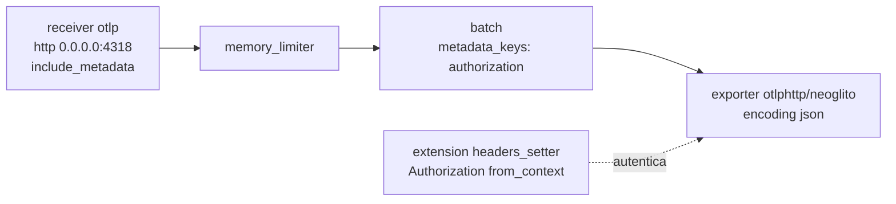
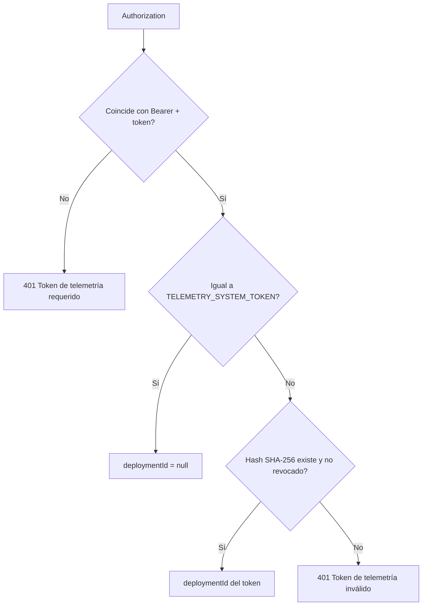

---
tags:
  - neoglito
  - telemetry
  - opentelemetry
  - documentacion-tecnica
funcionalidad: telemetry
actualizado: 2026-10-11
---

# Telemetry · collector y receptor

## El collector

Se ejecuta como servicio `otel-collector` de `docker-compose.yml` con la imagen `otel/opentelemetry-collector-contrib:0.162.0`. Se necesita la distribución *contrib* porque la extensión `headers_setter` no está en la distribución base. La configuración se monta de solo lectura desde `src/telemetry/infrastructure/collector/otel-collector.yaml`, y el puerto 4318 se publica en el host.

| Pieza | Configuración | Motivo |
| --- | --- | --- |
| `receivers.otlp.protocols.http` | `0.0.0.0:4318`, `include_metadata: true` | Expone los headers de entrada como metadata del contexto |
| `extensions.headers_setter` | `Authorization` ← `from_context: authorization` | Reenvía el token del emisor hasta la API |
| `processors.memory_limiter` | 256 MiB, picos de 64 MiB | Protege el contenedor |
| `processors.batch` | 1024 elementos o 5 s, `metadata_keys: [authorization]` | Un lote por token: sin esto se mezclarían datos de despliegues distintos |
| `exporters.otlphttp/neoglito` | `endpoint: ${env:NEOGLITO_INGEST_URL}`, `encoding: json`, `compression: none`, reintentos hasta 120 s | La API solo acepta JSON |

Los pipelines de `traces`, `metrics` y `logs` usan los mismos receptor, procesadores y exporter. El exporter añade `/v1/traces`, `/v1/metrics` y `/v1/logs` al endpoint configurado; por eso `NEOGLITO_INGEST_URL` vale `http://api:3000/telemetry/ingest` y la API publica rutas bajo `/telemetry/ingest/v1/`.

## El receptor en la API

`TelemetryIngestController` está en `src/telemetry/presentation` y se oculta de Swagger con `@ApiExcludeController`.

| Ruta | Método | Cuerpo |
| --- | --- | --- |
| `/telemetry/ingest/v1/traces` | POST | OTLP JSON `ExportTraceServiceRequest` |
| `/telemetry/ingest/v1/metrics` | POST | OTLP JSON `ExportMetricsServiceRequest` |
| `/telemetry/ingest/v1/logs` | POST | OTLP JSON `ExportLogsServiceRequest` |

- Si el `Content-Type` no es `application/json`, responde 415.
- `main.ts` sube el límite del cuerpo JSON a 10 MB (`app.useBodyParser('json', { limit: '10mb' })`); el valor por defecto de Express, 100 kB, no alcanza para lotes OTLP.
- `otlp-json-mapper.ts` traduce el JSON OTLP a entidades de dominio: identificadores en hexadecimal, tiempos en nanosegundos (cadenas) a `Date`, `AnyValue` a JSON plano y `service.name` del recurso a `serviceName`. Vive en `presentation/otlp/` para que la capa de aplicación no importe de infraestructura.
- `IngestTelemetryUseCase` recibe solo entidades de dominio y llama al repositorio si hay elementos.

## Autenticación del receptor

`TelemetryIngestGuard` reemplaza a `JwtAuthGuard` en esta ruta.

- Acepta `Bearer` seguido de espacio o de `%20`: algunos SDK codifican el espacio en `OTEL_EXPORTER_OTLP_HEADERS`.
- El token de sistema se compara por digests SHA-256 con `timingSafeEqual`, así la comparación no depende de la longitud.
- Los tokens por despliegue tienen el formato `ngt_` más 32 bytes aleatorios en base64url. Solo se guarda el hash (`hashTelemetryToken`). `issue` hace `upsert` por `deploymentId`, de modo que volver a desplegar reemplaza el token anterior y quita la revocación.
- Un 401 hace que el collector descarte el lote (`Exporting failed. Dropping data`), porque los errores 4xx no son reintentables.

## Evitar un bucle

La API se instrumenta a sí misma y envía telemetría al collector, que la reenvía a `/telemetry/ingest`. Si esa ruta también generara spans, cada ingesta produciría más telemetría. La instrumentación HTTP usa `ignoreIncomingRequestHook` para ignorar peticiones cuya URL empieza por `/telemetry/ingest` (`INGEST_PATH_PREFIX`).

Para configurar los emisores consulta [[Telemetry - Inyeccion en despliegues]] y [[Telemetry - API, ORM y retencion]].

## Fuentes del código

- [src/telemetry/infrastructure/collector/otel-collector.yaml](file:///C:/Users/Uriel-Galvan/Documents/Proyectos%20Programacion/neoglito/src/telemetry/infrastructure/collector/otel-collector.yaml)
- [src/telemetry/infrastructure/collector/README.md](file:///C:/Users/Uriel-Galvan/Documents/Proyectos%20Programacion/neoglito/src/telemetry/infrastructure/collector/README.md)
- [docker-compose.yml](file:///C:/Users/Uriel-Galvan/Documents/Proyectos%20Programacion/neoglito/docker-compose.yml)
- [src/main.ts](file:///C:/Users/Uriel-Galvan/Documents/Proyectos%20Programacion/neoglito/src/main.ts)
- [src/telemetry/presentation/telemetry-ingest.controller.ts](file:///C:/Users/Uriel-Galvan/Documents/Proyectos%20Programacion/neoglito/src/telemetry/presentation/telemetry-ingest.controller.ts)
- [src/telemetry/presentation/telemetry-ingest.guard.ts](file:///C:/Users/Uriel-Galvan/Documents/Proyectos%20Programacion/neoglito/src/telemetry/presentation/telemetry-ingest.guard.ts)
- [src/telemetry/presentation/otlp/otlp-json-mapper.ts](file:///C:/Users/Uriel-Galvan/Documents/Proyectos%20Programacion/neoglito/src/telemetry/presentation/otlp/otlp-json-mapper.ts)
- [src/telemetry/application/use-cases/ingest-telemetry.use-case.ts](file:///C:/Users/Uriel-Galvan/Documents/Proyectos%20Programacion/neoglito/src/telemetry/application/use-cases/ingest-telemetry.use-case.ts)
- [src/telemetry/infrastructure/persistence/prisma-deployment-telemetry-token.repository.ts](file:///C:/Users/Uriel-Galvan/Documents/Proyectos%20Programacion/neoglito/src/telemetry/infrastructure/persistence/prisma-deployment-telemetry-token.repository.ts)
- [src/telemetry/infrastructure/sdk/start-telemetry-sdk.ts](file:///C:/Users/Uriel-Galvan/Documents/Proyectos%20Programacion/neoglito/src/telemetry/infrastructure/sdk/start-telemetry-sdk.ts)
