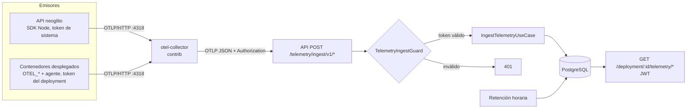
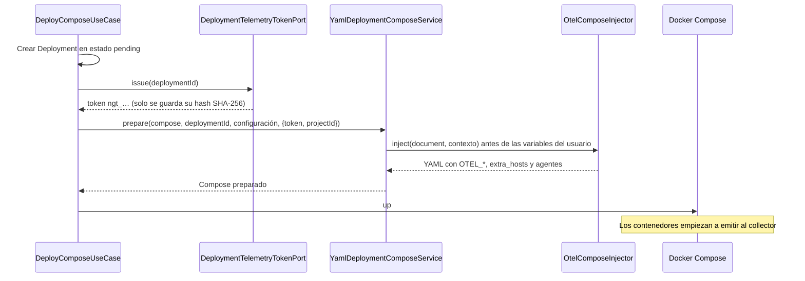
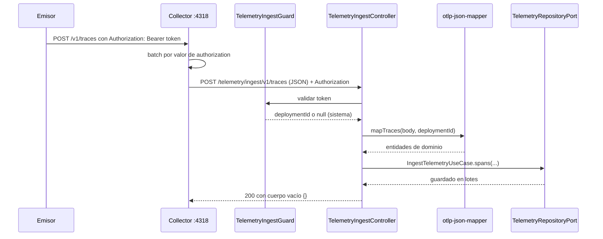

---
tags:
  - neoglito
  - telemetry
  - opentelemetry
  - documentacion-tecnica
funcionalidad: telemetry
actualizado: 2026-10-11
---

# Telemetry · flujo

## Vista general

Los emisores nunca hablan directamente con la API: siempre pasan por el collector. El collector conserva el header `Authorization` de cada emisor y lo reenvía; así la API sabe a qué despliegue pertenece cada lote.

## Alta de un despliegue

El token en claro existe únicamente dentro del YAML preparado del despliegue. En base de datos solo se almacena el hash. Si el arranque falla, el caso de uso revoca el token; si se detiene el despliegue, `StopDeploymentUseCase` también lo revoca.

## Camino de un lote de telemetría

El controller responde `{}` con `@Res()` para saltarse `ApiResponseInterceptor`: los exporters OTLP esperan la respuesta del protocolo, no el envelope `{success, data, error, meta}`. Los errores sí pasan por `ApiExceptionFilter`.

## Consulta

El frontend, o cualquier cliente con JWT, consulta `GET /deployment/:deploymentId/telemetry/{traces,metrics,logs}`. La respuesta usa el envelope normal y devuelve `{ items, nextBefore }` con paginación por cursor. Detalles en [[Telemetry - API, ORM y retencion]].

## Dos identidades de emisor

| Emisor | Token | `deploymentId` guardado |
| --- | --- | --- |
| Contenedor desplegado | `ngt_…` emitido por despliegue | UUID del `Deployment` |
| API neoglito | `TELEMETRY_SYSTEM_TOKEN` | `null` |

Un `deploymentId` nulo significa telemetría de la propia API. El endpoint de consulta filtra siempre por un despliegue existente, así que no la devuelve.

Continúa con [[Telemetry - Collector y receptor]] para el detalle de cada salto.

## Fuentes del código

- [src/telemetry/README.md](file:///C:/Users/Uriel-Galvan/Documents/Proyectos%20Programacion/neoglito/src/telemetry/README.md)
- [src/deployment/application/use-cases/deploy-compose.use-case.ts](file:///C:/Users/Uriel-Galvan/Documents/Proyectos%20Programacion/neoglito/src/deployment/application/use-cases/deploy-compose.use-case.ts)
- [src/deployment/infrastructure/compose/yaml-deployment-compose.service.ts](file:///C:/Users/Uriel-Galvan/Documents/Proyectos%20Programacion/neoglito/src/deployment/infrastructure/compose/yaml-deployment-compose.service.ts)
- [src/telemetry/presentation/telemetry-ingest.controller.ts](file:///C:/Users/Uriel-Galvan/Documents/Proyectos%20Programacion/neoglito/src/telemetry/presentation/telemetry-ingest.controller.ts)
- [src/telemetry/presentation/telemetry-ingest.guard.ts](file:///C:/Users/Uriel-Galvan/Documents/Proyectos%20Programacion/neoglito/src/telemetry/presentation/telemetry-ingest.guard.ts)
- [src/telemetry/presentation/otlp/otlp-json-mapper.ts](file:///C:/Users/Uriel-Galvan/Documents/Proyectos%20Programacion/neoglito/src/telemetry/presentation/otlp/otlp-json-mapper.ts)
- [src/telemetry/application/use-cases/ingest-telemetry.use-case.ts](file:///C:/Users/Uriel-Galvan/Documents/Proyectos%20Programacion/neoglito/src/telemetry/application/use-cases/ingest-telemetry.use-case.ts)
- [src/telemetry/infrastructure/persistence/prisma-deployment-telemetry-token.repository.ts](file:///C:/Users/Uriel-Galvan/Documents/Proyectos%20Programacion/neoglito/src/telemetry/infrastructure/persistence/prisma-deployment-telemetry-token.repository.ts)
