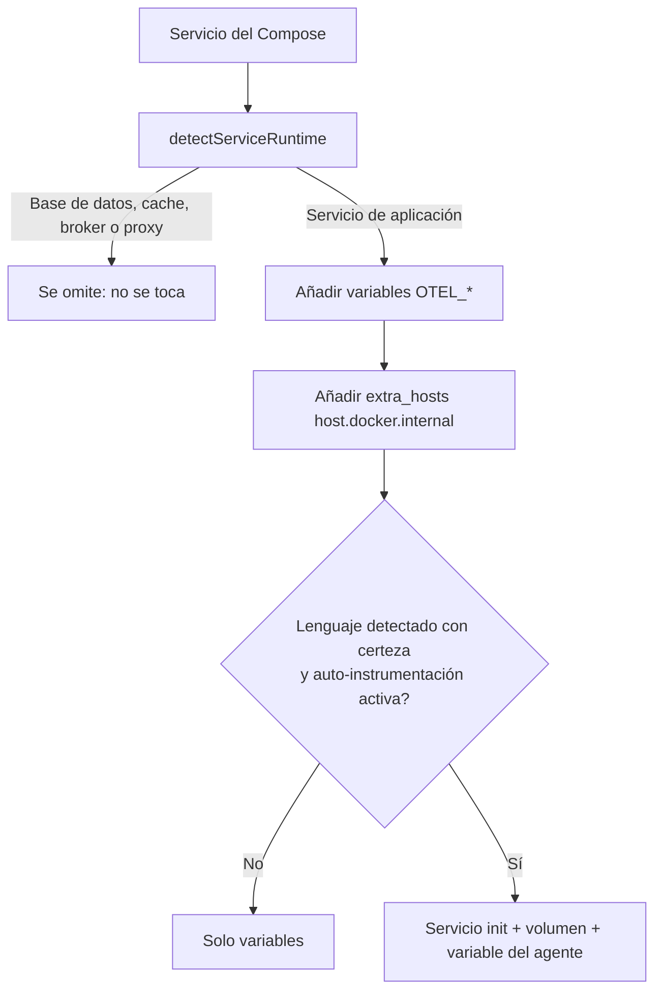
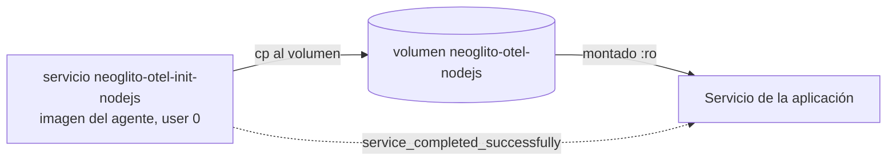

---
tags:
  - neoglito
  - telemetry
  - opentelemetry
  - documentacion-tecnica
funcionalidad: telemetry
actualizado: 2026-10-11
---

# Telemetry · inyección en despliegues

La inyección ocurre en `YamlDeploymentComposeService.prepare()`. Ese método ya reescribía `environment` y `ports` del Compose del usuario; ahora, si recibe configuración de telemetría y existe un inyector, invoca `OtelComposeInjector.inject()` **antes** de aplicar las variables del usuario.

## Qué servicios se instrumentan

`detectServiceRuntime` reutiliza `lookupImage` y `normalizeImageRef` del catálogo de imágenes de despliegue. Si la imagen es una base de datos, cache, broker o proxy conocido, el servicio **no** se instrumenta.

| Caso | Resultado |
| --- | --- |
| `image` conocida en el catálogo (postgres, redis, nginx…) | No instrumentable |
| `image` de `node`, `python` o familias Java (`eclipse-temurin`, `openjdk`, `amazoncorretto`, `maven`, `gradle`, `tomcat`…) | Instrumentable con runtime conocido |
| `build:` con Dockerfile cuya última etapa `FROM` es una imagen de esos lenguajes | Runtime de esa imagen |
| `build:` sin base reconocible | Se miran archivos marcadores: `package.json`, `requirements.txt`/`pyproject.toml`/`Pipfile`/`setup.py`, `pom.xml`/`build.gradle*` |
| Varios marcadores a la vez, `FROM` con `ARG` o contexto remoto | Instrumentable sin agente: **nunca se adivina** el lenguaje |

Una base `alpine` activa la variante musl del agente de Python.

## Variables inyectadas

| Variable | Valor |
| --- | --- |
| `OTEL_EXPORTER_OTLP_ENDPOINT` | `TELEMETRY_DEPLOYMENT_COLLECTOR_ENDPOINT` o `http://host.docker.internal:4318` |
| `OTEL_EXPORTER_OTLP_PROTOCOL` | `http/protobuf` |
| `OTEL_EXPORTER_OTLP_HEADERS` | `authorization=Bearer%20<token>` |
| `OTEL_SERVICE_NAME` | Nombre del servicio en el Compose |
| `OTEL_RESOURCE_ATTRIBUTES` | `neoglito.deployment.id=…,neoglito.project.id=…` (se anexa si ya existía) |
| `OTEL_TRACES_EXPORTER`, `OTEL_METRICS_EXPORTER`, `OTEL_LOGS_EXPORTER` | `otlp` |

Se añade también `extra_hosts: host.docker.internal:host-gateway` para que el contenedor alcance el puerto 4318 publicado en el host.

**Regla de precedencia:** el inyector no pisa una clave que el Compose original o el usuario ya definieron (`setDefault`). Las variables que admiten valores combinados (`NODE_OPTIONS`, `JAVA_TOOL_OPTIONS`, `PYTHONPATH`, `OTEL_RESOURCE_ATTRIBUTES`) se anexan en lugar de sustituirse.

## Auto-instrumentación por lenguaje

Si el lenguaje se detecta y `TELEMETRY_AUTO_INSTRUMENTATION` no vale `false`, se monta un agente de las imágenes del OpenTelemetry Operator con tags fijados:

| Runtime | Imagen | Variable que activa el agente |
| --- | --- | --- |
| Node | `autoinstrumentation-nodejs:0.78.0` | `NODE_OPTIONS=--require <ruta>/autoinstrumentation.js` |
| Java | `autoinstrumentation-java:2.32.0` | `JAVA_TOOL_OPTIONS=-javaagent:<ruta>/javaagent.jar` |
| Python | `autoinstrumentation-python:0.66b1` | `PYTHONPATH` + `OTEL_PYTHON_LOGGING_AUTO_INSTRUMENTATION_ENABLED=true` |

Las imágenes se pueden cambiar con `TELEMETRY_AUTOINSTRUMENTATION_NODEJS_IMAGE`, `…_JAVA_IMAGE` y `…_PYTHON_IMAGE`.

1. Se crea un servicio init `neoglito-otel-init-<variante>` que copia el agente al volumen nombrado `neoglito-otel-<variante>`. Corre como `user: '0'` porque el volumen nuevo pertenece a root.
2. La aplicación monta ese volumen en solo lectura y espera al init con `depends_on: service_completed_successfully`.
3. Si varios servicios usan el mismo lenguaje, comparten un único init y un único volumen.

Los servicios init terminan en estado `exited`. Para que no aparezcan como servicios del usuario, `DockerComposeRuntime.list()` filtra los que empiezan por `neoglito-otel-init-` (`INJECTED_SERVICE_PREFIX`).

## Ciclo de vida del token

| Evento | Acción |
| --- | --- |
| Crear despliegue | `issue()` y paso del token a `prepare()` como cuarto argumento |
| Fallo durante el arranque | `revoke()` en el `catch` de `DeployComposeUseCase` |
| Detener despliegue | `StopDeploymentUseCase` llama a `revoke()` |
| Borrar el despliegue | La fila del token se elimina en cascada |

Con `TELEMETRY_ENABLED=false` no se emite token ni se inyecta nada. Más sobre la preparación del Compose en [[Deployment - Preparacion Compose]].

## Fuentes del código

- [src/deployment/infrastructure/compose/yaml-deployment-compose.service.ts](file:///C:/Users/Uriel-Galvan/Documents/Proyectos%20Programacion/neoglito/src/deployment/infrastructure/compose/yaml-deployment-compose.service.ts)
- [src/deployment/application/use-cases/deploy-compose.use-case.ts](file:///C:/Users/Uriel-Galvan/Documents/Proyectos%20Programacion/neoglito/src/deployment/application/use-cases/deploy-compose.use-case.ts)
- [src/deployment/application/ports/deployment-compose.port.ts](file:///C:/Users/Uriel-Galvan/Documents/Proyectos%20Programacion/neoglito/src/deployment/application/ports/deployment-compose.port.ts)
- [src/telemetry/application/ports/telemetry-injector.port.ts](file:///C:/Users/Uriel-Galvan/Documents/Proyectos%20Programacion/neoglito/src/telemetry/application/ports/telemetry-injector.port.ts)
- [src/telemetry/infrastructure/injection/otel-compose-injector.service.ts](file:///C:/Users/Uriel-Galvan/Documents/Proyectos%20Programacion/neoglito/src/telemetry/infrastructure/injection/otel-compose-injector.service.ts)
- [src/telemetry/infrastructure/injection/service-runtime-detector.ts](file:///C:/Users/Uriel-Galvan/Documents/Proyectos%20Programacion/neoglito/src/telemetry/infrastructure/injection/service-runtime-detector.ts)
- [src/telemetry/infrastructure/injection/auto-instrumentation-catalog.ts](file:///C:/Users/Uriel-Galvan/Documents/Proyectos%20Programacion/neoglito/src/telemetry/infrastructure/injection/auto-instrumentation-catalog.ts)
- [src/container/infrastructure/docker/docker-compose-runtime.service.ts](file:///C:/Users/Uriel-Galvan/Documents/Proyectos%20Programacion/neoglito/src/container/infrastructure/docker/docker-compose-runtime.service.ts)
